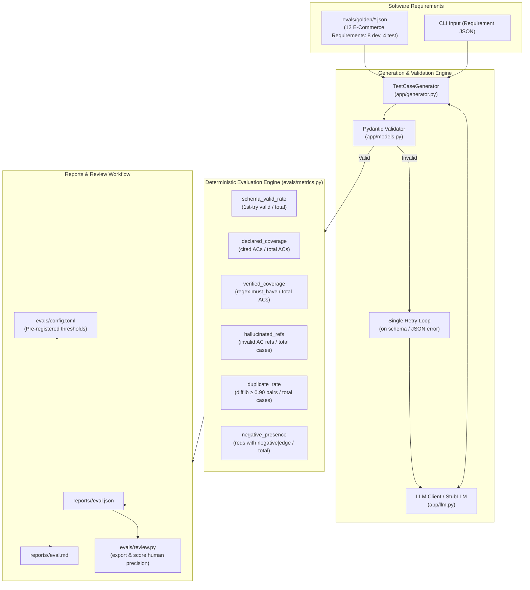

# Test Case Generator & Deterministic Evaluation Suite

An automated test case generation engine and deterministic evaluation framework for software requirements, designed for Forward Deployed AI Engineers and Agentic QA workflows. Built using Python, Pydantic validation, OpenAI-compatible local LLM connectivity (Ollama / vLLM), and a 6-metric evaluation harness with pre-registered quality thresholds.

---

## Architecture Overview



---

## The 6 Core Evaluation Metrics

LLM-based test generation requires quantitative, reproducible measurement rather than superficial spot checks. This suite evaluates 6 orthogonal quality dimensions across requirements:

### 1. `schema_valid_rate` (First-Attempt Structural Compliance)
- **What it measures:** The fraction of requirements where the LLM generated syntactically valid JSON conforming directly to the Pydantic `TestCase` schema on the very first attempt without requiring a retry.
- **What it does NOT measure:** It does not assess whether the test steps make functional sense, nor whether the preconditions are feasible. An answer can be completely valid schema-wise while describing a nonsensical user flow.

### 2. `declared_coverage` (Self-Reported Criterion Citation)
- **What it measures:** The proportion of requirement acceptance criteria referenced in the `covers` field of at least one generated test case.
- **What it does NOT measure:** It measures only what the model *claims* about itself. A model can cite every criterion ID while writing generic or unrelated verification steps that test none of them.

### 3. `verified_coverage` (Independent Regex-Grounded Coverage)
- **What it measures:** The proportion of acceptance criteria where at least one test case citing it actually matches explicit, hand-crafted regular expressions (`must_have`) in its steps or expected outcome (e.g. verifying exact boundary quantities like `5 intentos`, monetary limits like `50 USD`, or exact error strings).
- **What it does NOT measure:** It depends strictly on the hand-crafted regular expressions written by QA engineers in the golden set. It cannot prove thorough testing of unpatterned nuances or holistic user experience.

### 4. `hallucinated_refs` (Referential Integrity & Anti-Hallucination)
- **What it measures:** The proportion of generated test cases that cite nonexistent criterion IDs (e.g. fabricating `AC-09` or `AC-99` when the requirement only defines `AC-01` through `AC-04`).
- **What it does NOT measure:** It does not detect semantic misalignment where a model cites a real, existing criterion ID that is completely unrelated to what that specific test case executes.

### 5. `duplicate_rate` (Lexical Redundancy Detection)
- **What it measures:** The ratio of test case pairs within the same requirement exhibiting a `difflib.SequenceMatcher` similarity $\ge 0.90$ across combined titles and action steps, divided by total test cases.
- **What it does NOT measure:** It only identifies lexical/textual repetition. It will not flag semantically redundant test cases that test the same condition but are articulated with entirely distinct vocabulary.

### 6. `negative_presence` (Adversarial & Edge Coverage)
- **What it measures:** The proportion of requirements that contain at least one test case classified as `negative` or `edge`.
- **What it does NOT measure:** It does not measure whether the negative test scenario is subtle, effective, or explores high-impact failure modes—only that negative/boundary exploration was produced.

---

## Pre-Registered Quality Thresholds

Thresholds are pre-registered in [`evals/config.toml`](evals/config.toml) prior to benchmarking any candidate model, eliminating post-hoc threshold adjustment:

| Metric | Target Operator | Threshold | Rationale |
| :--- | :---: | :---: | :--- |
| `schema_valid_rate` | $\ge$ | **90.0%** | Minimizes retry latency and parse failures in CI/CD pipelines. |
| `verified_coverage` | $\ge$ | **70.0%** | Requires concrete assertions over critical boundary conditions and errors. |
| `hallucinated_refs` | $\le$ | **2.0%** | Enforces referential integrity against non-existent acceptance criteria. |
| `duplicate_rate` | $\le$ | **10.0%** | Prevents token waste and QA review fatigue from redundant cases. |
| `negative_presence` | $\ge$ | **100.0%** | Every feature must include at least one negative or boundary test case. |

---

## Dataset Splits: E-Commerce Store

The evaluation suite incorporates 12 golden requirements (`evals/golden/`) reflecting a fictional e-commerce platform:

- **Split `dev` (8 requirements):**
  - `REQ-01`: User authentication, session control, and lockout after 5 failed attempts.
  - `REQ-02`: New customer registration, password strength, and duplicate email prevention.
  - `REQ-03`: Product catalog search, category filtering, and price boundaries.
  - `REQ-04`: Shopping cart quantities, inventory limits, and real-time total recalculation.
  - `REQ-05`: Promotional coupon redemption, expiration, minimum purchase, and single-use rules.
  - `REQ-06`: Payment gateway checkout, 16-digit card validation, CVV, and timeout retries.
  - `REQ-07`: Delivery address book, 5-digit postal code format, and 5-address cap.
  - `REQ-08`: Return request processing, 30-day window, photo evidence, and hygiene exclusions.

- **Split `test` (4 held-out requirements):**
  - `REQ-09`: Real-time shipment status transitions and carrier tracking links.
  - `REQ-10`: Customer wishlist management, privacy, and cart transfer.
  - `REQ-11`: Verified buyer product reviews, 1-5 star ratings, and profanity filtering.
  - `REQ-12`: Out-of-stock restock email subscriptions and unsubscribe handling.

---

## How to Run

### 1. Environment Setup

```bash
uv venv .venv
uv pip install -r requirements.txt -r requirements-dev.txt
```

### 2. Single Requirement Generation CLI

Generate test cases from any standalone requirement JSON:

```bash
# Using the deterministic rule stub:
.venv\Scripts\python.exe -m app.generate evals/golden/REQ-01-login.json --model stub

# Using a local Ollama model:
.venv\Scripts\python.exe -m app.generate evals/golden/REQ-01-login.json --model llama3.2
```

### 3. Running the Evaluation Suite

Run the evaluation runner over the `dev` or `test` split:

```bash
# Run harness self-evaluation against the dev split:
.venv\Scripts\python.exe -m evals.runner --model stub --split dev

# Run against a local model on Ollama:
.venv\Scripts\python.exe -m evals.runner --model llama3.2 --split dev
```

Reports are automatically saved to `reports/<model>/eval.json` and `reports/<model>/eval.md`.

### 4. Human Review & Precision Scoring Workflow

To measure real human precision without guessing numbers:

1. **Export the human review sheet:**
   ```bash
   .venv\Scripts\python.exe -m evals.review export --model stub
   ```
   This generates `reports/stub/review.md` with an empty `Review (OK/wrong/edit)` column.

2. **Conduct the review:**
   A human QA engineer fills each row with `OK`, `wrong`, or `edit`.

3. **Compute the precision score:**
   ```bash
   .venv\Scripts\python.exe -m evals.review score --model stub
   ```
   If no rows are filled, the command explicitly reports that no review was completed—it never fabricates a score.

### 5. Running Quality Checks & Tests

```bash
.venv\Scripts\python.exe -m pytest -q
.venv\Scripts\python.exe -m ruff check .
```

---

## Results

<!-- RESULTS -->
Model: `qwen3:4b-instruct-2507-q4_K_M` on Ollama, temperature 0, laptop CPU, 2026-11-11. The thresholds were written in `evals/config.toml` before any real model ran. The test split was run once.

| Metric | Threshold | Dev, run 1 (8 requirements, 70 cases) | Dev, run 2 (8 requirements, 66 cases) | Test (4 requirements, 31 cases) |
|---|---|---|---|---|
| Schema valid on first try | ≥ 90% | 75.0% | 87.5% | **75.0% · fails** |
| Declared coverage | ≥ 70% (default in the runner, not pre-registered) | 100% | 100% | 100% |
| Verified coverage | ≥ 70% | 56.2% | 90.6% | **93.8% · passes** |
| Hallucinated criterion references | ≤ 2% | 2.9% | 1.5% | **3.2% · fails** |
| Duplicate cases | ≤ 10% | 2.9% | 12.1% | **6.5% · passes** |
| Negative or edge case present | 100% | 100% | 100% | **100% · passes** |

On the test split the model meets 3 of the 5 thresholds and does not pass.

- **What changed between the two dev runs.** In run 1 the model wrote its cases in English for requirements written in Spanish, and the `must_have` expressions are Spanish. Verified coverage of 56.2% measured the language mismatch more than the coverage. One line was added to the prompt (write in the language of the requirement) and run 2 gave 90.6%. This was found and changed on the dev split, before the test split was touched. Run 1 is kept in [`reports/qwen3-4b-dev-run1-english-output`](reports/qwen3-4b-dev-run1-english-output/eval.md).
- **Declared versus verified.** The model cites every acceptance criterion in every run, so declared coverage is always 100% and says nothing. Verified coverage is the number that moved.
- **The two failures are small counts.** One of the 4 test requirements needed the retry before its JSON validated, and 1 of the 31 cases cites a criterion id that does not exist. With 4 requirements, one retry is 25 points: the split is too small to separate 75% from 90% reliably.
- **Not done.** No human has reviewed the generated cases yet, so there is no precision figure: `evals/review.py score` reports that until a filled review sheet exists. The `must_have` expressions were written by hand and a case can match one without being a good test.

Reports: [dev run 2](reports/qwen3-4b-dev-run2/eval.md) · [test](reports/qwen3-4b-test/eval.md). Each `eval.json` keeps the raw model response per requirement.

### Harness Self-Check (`--model stub`)

The rule-guided `StubLLM` serves as a deterministic self-check of the evaluation harness, confirming that the prompt builder, Pydantic parser, regular expressions, and threshold comparison logic operate in total agreement:

- **Split Evaluated:** `dev` (8 requirements)
- **Total Test Cases Generated:** 32 test cases (4 per requirement across smoke, functional, negative, and edge)
- **Schema Valid Rate:** 100.0% (Threshold: $\ge$ 90.0%) — **PASS**
- **Verified Regex Coverage:** 100.0% (Threshold: $\ge$ 70.0%) — **PASS**
- **Hallucinated Criterion Refs:** 0.0% (Threshold: $\le$ 2.0%) — **PASS**
- **Duplicate Case Rate:** 0.0% (Threshold: $\le$ 10.0%) — **PASS**
- **Negative/Edge Presence:** 100.0% (Threshold: $\ge$ 100.0%) — **PASS**

*The stub result validates harness integrity and self-consistency; it is not a measurement of an artificial intelligence model.* Full run details are preserved in [`reports/stub/eval.md`](reports/stub/eval.md).
