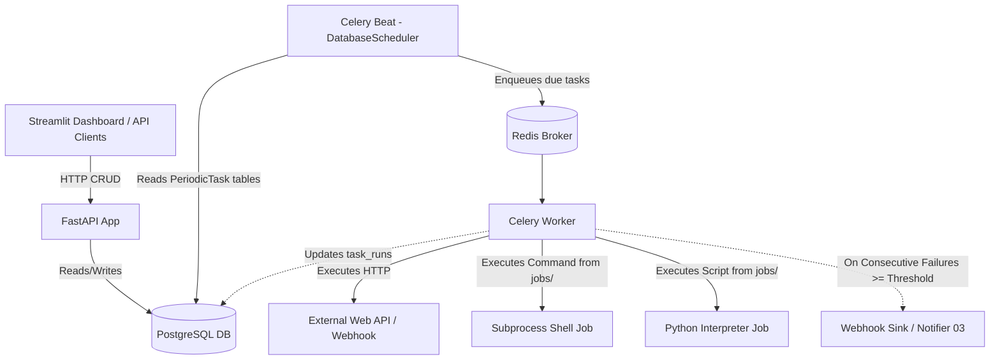

# Project: Task Scheduler Engine

## 1. Problem Statement
Managing background jobs via standard `cron` is fragile: it lacks visibility, doesn't support complex retries natively, provides poor alerting on failures, and offers no out-of-the-box way to chain tasks together (e.g., Run Task B only if Task A succeeds). 

This Task Scheduler Engine provides a modern, visual alternative to manage, execute, monitor, and retry background jobs. It orchestrates HTTP requests, shell commands, and Python scripts with robust dependency management, database-backed state, and dynamic scheduling.

## 2. Architecture
Celery Beat runs with a PostgreSQL-backed scheduler from the maintained `sqlalchemy-celery-beat` package, so schedules can be added, changed or paused at runtime without restarting Beat. The API owns the `tasks` table and keeps one `PeriodicTask` row (the library's own table) in sync with each task.



## 3. Features
- **Dynamic Scheduling**: Add, modify, or delete tasks on the fly without restarting the scheduler. Beat's `DatabaseScheduler` picks up changes to the `PeriodicTask` tables automatically.
- **Execution Types**: 
  - *HTTP Requests* (webhooks, API polling) with SSRF protection against private networks (`ALLOW_PRIVATE_TARGETS=true` for demo/testing).
  - *Shell Commands* (scripts strictly whitelisted inside `jobs/`, without `shell=True`, with timeout and output limit).
  - *Python Scripts* (scripts strictly whitelisted inside `jobs/`, without `eval`, with timeout and output limit).
- **Retry Mechanism**: Configurable exponential backoff leveraging Celery's native retry features.
- **History & Logs**: Retain stdout, stderr, exit codes, run durations, and completion states in PostgreSQL.
- **Dependencies**: Execute Task B only if Task A's last *finished* run was successful (a run of A still in progress at the same tick is ignored); otherwise, mark Task B as `SKIPPED`.
- **Alerting**: Integration with a central Notification Hub (`ALERT_WEBHOOK_URL`, compatible with project `03-multi-channel-notifier` and `webhook-sink`) upon exceeding consecutive failure thresholds.

## 4. Tech Stack
- **API**: FastAPI 0.143+
- **Engine**: Celery 5.6+ with Redis broker and `sqlalchemy-celery-beat` (`DatabaseScheduler`)
- **Database**: PostgreSQL 15 (SQLAlchemy 2.1+)
- **UI Dashboard**: Streamlit 1.66+
- **Alert Sink**: `mendhak/http-https-echo:36`
- **Deployment**: Docker Compose

## 5. Environment Variables
Configure these in your `.env` (see `.env.example`):

```ini
# Database
POSTGRES_USER=user
POSTGRES_PASSWORD=password
POSTGRES_DB=scheduler
DATABASE_URL=postgresql+psycopg2://user:password@db:5432/scheduler

# Redis / Celery
REDIS_URL=redis://redis:6379/0

# Alerting / Webhook Sink
ALERT_WEBHOOK_URL=http://webhook-sink:8080/
ALERT_WEBHOOK_TOKEN=change_me_webhook_token
FAILURE_ALERT_THRESHOLD=3

# Security & Execution limits
ALLOW_PRIVATE_TARGETS=false
JOBS_DIR=jobs
EXECUTION_TIMEOUT_SECONDS=30
MAX_OUTPUT_BYTES=100000

# Retries
MAX_RETRIES=3
BASE_BACKOFF_SECONDS=5

# Dashboard
API_URL=http://api:8000
```

## 6. Database Schema
```sql
CREATE EXTENSION IF NOT EXISTS "uuid-ossp";

CREATE TABLE tasks (
    task_id UUID PRIMARY KEY DEFAULT uuid_generate_v4(),
    name VARCHAR(255) NOT NULL,
    task_type VARCHAR(50) NOT NULL, -- HTTP, SHELL, PYTHON
    payload JSONB NOT NULL,
    schedule VARCHAR(100), -- Cron expression
    max_retries INT DEFAULT 3,
    retry_backoff INT DEFAULT 60,
    is_active BOOLEAN DEFAULT TRUE,
    last_run_at TIMESTAMP,
    consecutive_failures INT DEFAULT 0,
    created_at TIMESTAMP DEFAULT NOW()
);

CREATE TABLE task_runs (
    run_id UUID PRIMARY KEY DEFAULT uuid_generate_v4(),
    task_id UUID REFERENCES tasks(task_id) ON DELETE CASCADE,
    status VARCHAR(50) NOT NULL, -- SUCCESS, FAILED, RUNNING, SKIPPED, RETRYING
    stdout TEXT,
    stderr TEXT,
    exit_code INT,
    started_at TIMESTAMP DEFAULT NOW(),
    finished_at TIMESTAMP,
    duration_ms INT
);

CREATE TABLE task_dependencies (
    task_id UUID REFERENCES tasks(task_id) ON DELETE CASCADE,
    depends_on_task_id UUID REFERENCES tasks(task_id) ON DELETE CASCADE,
    PRIMARY KEY (task_id, depends_on_task_id)
);

CREATE INDEX idx_tasks_active ON tasks(is_active);
CREATE INDEX idx_tasks_polling ON tasks(is_active, last_run_at);
CREATE INDEX idx_task_runs_task_id ON task_runs(task_id);
```

## 7. API Endpoints

Every `/api/v1/*` route requires `Authorization: Bearer $API_KEY` (`change_me_api_key` in `.env.example`); without it the API answers `401`. The API can run scripts, so it is never left open. `/health` is public.

### 7.1 POST /api/v1/tasks
Create a new task.
```bash
curl -X POST "http://localhost:8006/api/v1/tasks" -H "Authorization: Bearer $API_KEY" \
  -H "Content-Type: application/json" \
  -d '{
    "name": "Nightly Database Backup",
    "task_type": "SHELL",
    "payload": {"command": "backup.sh", "args": ["db_prod"]},
    "schedule": "0 2 * * *",
    "max_retries": 3,
    "retry_backoff": 60,
    "depends_on": []
  }'
```
**Response:**
```json
{
  "task_id": "e4b3c2a1-...",
  "name": "Nightly Database Backup",
  "status": "CREATED"
}
```

### 7.2 GET /api/v1/tasks
List all tasks.
```bash
curl -X GET "http://localhost:8006/api/v1/tasks" -H "Authorization: Bearer $API_KEY"
```

### 7.3 GET /api/v1/tasks/{id}
Get a single task by ID.
```bash
curl -X GET "http://localhost:8006/api/v1/tasks/e4b3c2a1-..." -H "Authorization: Bearer $API_KEY"
```

### 7.4 PUT /api/v1/tasks/{id}
Update a task (e.g. toggle pause/resume, change schedule).
```bash
curl -X PUT "http://localhost:8006/api/v1/tasks/e4b3c2a1-..." -H "Authorization: Bearer $API_KEY" \
  -H "Content-Type: application/json" \
  -d '{
    "is_active": false,
    "schedule": "30 2 * * *"
  }'
```

### 7.5 DELETE /api/v1/tasks/{id}
Delete a task.
```bash
curl -X DELETE "http://localhost:8006/api/v1/tasks/e4b3c2a1-..." -H "Authorization: Bearer $API_KEY"
```

### 7.6 POST /api/v1/tasks/{id}/trigger
Manually trigger a task immediately, ignoring schedule.
```bash
curl -X POST "http://localhost:8006/api/v1/tasks/e4b3c2a1-.../trigger" -H "Authorization: Bearer $API_KEY"
```

### 7.7 GET /api/v1/tasks/{id}/runs
Get execution history with logs for a specific task.
```bash
curl -X GET "http://localhost:8006/api/v1/tasks/e4b3c2a1-.../runs?limit=5" -H "Authorization: Bearer $API_KEY"
```

## 8. Docker Services

In `docker-compose.yml`:
- `api`: FastAPI on `127.0.0.1:8006:8000`
- `dashboard`: Streamlit on `127.0.0.1:8506:8501`
- `scheduler`: Celery Beat with `DatabaseScheduler`
- `worker`: Celery Worker
- `db`: PostgreSQL 15-alpine (internal to docker network, no host port published)
- `redis`: Redis 7-alpine (internal to docker network, no host port published)
- `webhook-sink`: `mendhak/http-https-echo:36` (internal echo sink for failure alerts)

## 9. File Structure
```
06-scheduler-engine/
├── app/
│   ├── api/
│   │   ├── routes.py
│   │   └── schemas.py
│   ├── core/
│   │   ├── celery_app.py
│   │   └── config.py
│   ├── executors/
│   │   ├── base.py
│   │   ├── http_executor.py
│   │   ├── shell_executor.py
│   │   └── python_executor.py
│   ├── models/
│   │   └── database.py
│   └── main.py
├── dashboard/
│   └── app.py
├── jobs/
│   ├── backup.sh
│   ├── demo_dependent.py
│   ├── demo_failure.py
│   └── demo_success.py
├── tests/
│   ├── conftest.py
│   ├── test_api.py
│   ├── test_executors.py
│   ├── test_integration.py
│   └── test_scheduler_logic.py
├── .env.example
├── .gitignore
├── Dockerfile
├── docker-compose.yml
├── init-db.sql
├── pyproject.toml
├── requirements.txt
└── requirements-dev.txt
```

## 10. Verification Commands

1. **Unit test suite & coverage**:
   ```powershell
   .venv\Scripts\pytest.exe -q
   ```
2. **Quality & style checks**:
   ```powershell
   .venv\Scripts\ruff.exe check .
   ```
3. **Full stack deployment**:
   ```powershell
   docker compose up -d --build
   docker compose ps
   ```
4. **Integration tests against stack**:
   ```powershell
   .venv\Scripts\pytest.exe -m integration -q
   ```
5. **Teardown**:
   ```powershell
   docker compose down -v
   ```
