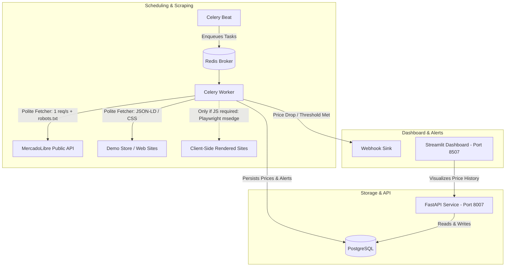

# Project 07: E-Commerce Price Monitor (Polite Scraping)

## 1. Problem Statement
Monitoring product prices across e-commerce platforms is a tedious, manual task. Consumers and businesses lose money by missing out on temporary price drops and promotions. However, aggressive scraping with bot-evasion tactics violates terms of service, strains vendor servers, and leads to IP bans.

This project implements a **polite, scalable E-Commerce Price Monitor** that tracks prices responsibly. It respects `robots.txt`, identifies itself with a transparent `User-Agent`, enforces domain rate limits, and uses official APIs whenever available (such as MercadoLibre's public item API). For custom e-commerce pages, it parses structured schema data (`JSON-LD Product/Offer`) or configurable CSS selectors using standard HTTP requests (`httpx`), falling back to headless Microsoft Edge via Playwright only when client-side JavaScript rendering is strictly required.

The system stores historical price data in PostgreSQL, dispatches automated webhook alerts upon detecting price drops or threshold breaches, and provides an interactive Streamlit + Plotly dashboard for price curve analysis.

## 2. Architecture & Tech Stack

### 2.1 Architecture Diagram



### 2.2 Tech Stack
*   **Web Scraping & Fetching:** Polite HTTP via `httpx` (identifiable User-Agent, `robots.txt` compliance, 1 req/s rate limit, `tenacity` retry with exponential backoff); BeautifulSoup4 (`bs4`) for HTML and JSON-LD parsing; Playwright (Microsoft Edge `channel="msedge"`) strictly for JavaScript-dependent pages.
*   **Scheduling & Background Jobs:** Celery Beat (periodic execution every N minutes), Celery Worker, Redis (broker and backend).
*   **Database:** PostgreSQL 16 (Products, Price History, Alerts, Scraping Logs) with SQLAlchemy.
*   **Backend API:** FastAPI (RESTful CRUD, history, CSV export, Bearer token authentication).
*   **Frontend Dashboard:** Streamlit + Plotly (price history curves and alert visualization).
*   **Infrastructure & Mocks:** Docker, Docker Compose, Nginx demo store (`demo-store`), `mendhak/http-https-echo` (`webhook-sink`).

## 3. Polite Scraping Policy

Unlike aggressive scrapers that rely on stealth libraries, proxy rotation, and anti-bot evasion, this monitor follows ethical web scraping principles:
1.  **Robots.txt Adherence:** Checks `robots.txt` before fetching and halts if the path is disallowed.
2.  **Identifiable User-Agent:** Sends `PriceMonitorBot/1.0 (+https://example.com/bot)` so webmasters can identify the crawler and contact the maintainer.
3.  **Strict Rate Limiting:** Enforces a minimum interval (default: 1.0 second between requests per domain) to prevent overloading target servers.
4.  **Exponential Backoff:** Retries 429 (Too Many Requests) and 5xx responses gracefully using `tenacity` without spamming the host.
5.  **Prefer Official APIs & Structured Data:** Prioritizes official APIs (e.g. MercadoLibre Item API) and semantic `JSON-LD` schema over brittle CSS selectors.
7.  **SSRF Guard:** Product URLs come from API users, so only `http(s)` URLs are accepted and every request (redirects included) to a loopback, private or link-local address is refused. The demo compose sets `ALLOW_PRIVATE_TARGETS=true` only because the demo store lives on the Docker network.
6.  **No Amazon Scraping:** Excludes Amazon scraping in accordance with site policies.

## 4. Database Schema

```sql
CREATE TABLE products (
    id UUID PRIMARY KEY DEFAULT gen_random_uuid(),
    name VARCHAR(255) NOT NULL,
    url TEXT UNIQUE NOT NULL,
    site_domain VARCHAR(100) NOT NULL,
    css_selectors JSONB,
    target_price DECIMAL(10, 2),
    alert_threshold_pct DECIMAL(5, 2) DEFAULT 5.0,
    alert_threshold_abs DECIMAL(10, 2) DEFAULT 0.0,
    currency VARCHAR(10) DEFAULT 'USD',
    check_interval_hours INTEGER DEFAULT 6,
    requires_js BOOLEAN DEFAULT FALSE,
    is_active BOOLEAN DEFAULT TRUE,
    last_scraped_at TIMESTAMP WITH TIME ZONE,
    created_at TIMESTAMP WITH TIME ZONE DEFAULT CURRENT_TIMESTAMP,
    updated_at TIMESTAMP WITH TIME ZONE DEFAULT CURRENT_TIMESTAMP
);

CREATE TABLE price_history (
    id UUID PRIMARY KEY DEFAULT gen_random_uuid(),
    product_id UUID REFERENCES products(id) ON DELETE CASCADE,
    price DECIMAL(10, 2) NOT NULL,
    currency VARCHAR(10) DEFAULT 'USD',
    availability BOOLEAN DEFAULT TRUE,
    rating DECIMAL(3, 2),
    reviews_count INTEGER,
    seller_reputation VARCHAR(100),
    shipping_info TEXT,
    screenshot_path TEXT,
    scraped_at TIMESTAMP WITH TIME ZONE DEFAULT CURRENT_TIMESTAMP
);

CREATE TABLE alerts (
    id UUID PRIMARY KEY DEFAULT gen_random_uuid(),
    product_id UUID REFERENCES products(id) ON DELETE CASCADE,
    old_price DECIMAL(10, 2),
    new_price DECIMAL(10, 2),
    alert_type VARCHAR(50),
    status VARCHAR(50),
    sent_at TIMESTAMP WITH TIME ZONE DEFAULT CURRENT_TIMESTAMP
);

CREATE TABLE scraping_logs (
    id UUID PRIMARY KEY DEFAULT gen_random_uuid(),
    product_id UUID REFERENCES products(id) ON DELETE CASCADE,
    status VARCHAR(50),
    error_message TEXT,
    executed_at TIMESTAMP WITH TIME ZONE DEFAULT CURRENT_TIMESTAMP
);

CREATE INDEX idx_price_history_product_time ON price_history(product_id, scraped_at);
CREATE INDEX idx_alerts_product ON alerts(product_id);
CREATE INDEX idx_scraping_logs_product ON scraping_logs(product_id, executed_at);
```

## 5. API Endpoints

All `/api/v1/*` endpoints require `Authorization: Bearer <API_TOKEN>` (configured in `.env`). The `/health` endpoint is unauthenticated.

| Method | Endpoint | Description |
| :--- | :--- | :--- |
| `GET` | `/health` | Service healthcheck (Postgres connectivity) |
| `POST` | `/api/v1/products/` | Register a new product to monitor |
| `GET` | `/api/v1/products/` | List all monitored products (optional `is_active` filter) |
| `GET` | `/api/v1/products/{id}` | Get product details |
| `PATCH` | `/api/v1/products/{id}` | Update product thresholds, intervals, or active state |
| `DELETE`| `/api/v1/products/{id}` | Remove a product and its history |
| `POST` | `/api/v1/products/{id}/scrape` | Force an immediate scrape for a product |
| `GET` | `/api/v1/products/{id}/history` | Get time-series price history |
| `GET` | `/api/v1/products/{id}/alerts` | Get alerts triggered for a product |
| `GET` | `/api/v1/alerts/` | List all recent alerts across all products |
| `GET` | `/api/v1/export/csv` | Export price history as downloadable CSV |

## 6. Demo Store & Price Manipulation

To verify and test price monitoring without requiring internet connectivity or third-party e-commerce platforms, the Docker stack includes a fictional static store (`demo-store`) served by Nginx on port `8087`.

Products included in the demo store:
- `http://127.0.0.1:8087/products/keyboard.html` (Mechanical Keyboard RGB - $120.00)
- `http://127.0.0.1:8087/products/headphones.html` (Studio Monitor Headphones - $85.00)

Both pages provide semantic HTML and structured `JSON-LD` (`schema.org/Product` and `Offer`).

To simulate a price drop and trigger an alert:
```bash
python demo-store/update_price.py headphones 65.00
```
This updates both the HTML price display and the `JSON-LD` metadata in real-time.

## 7. Ports & Docker Services

| Service | Container Image | Published Host Port | Description |
| :--- | :--- | :--- | :--- |
| `api` | Built from `Dockerfile` | `127.0.0.1:8007:8000` | FastAPI REST API |
| `dashboard` | Built from `Dockerfile` | `127.0.0.1:8507:8501` | Streamlit + Plotly Dashboard |
| `demo-store` | `nginx:alpine` | `127.0.0.1:8087:80` | Fictional e-commerce demo site |
| `postgres` | `postgres:16-alpine` | Internal only | Database storage |
| `redis` | `redis:7-alpine` | Internal only | Celery broker & backend |
| `worker` | Built from `Dockerfile` | Internal only | Celery task worker |
| `beat` | Built from `Dockerfile` | Internal only | Celery Beat periodic scheduler |
| `webhook-sink` | `mendhak/http-https-echo:latest` | Internal only | Webhook listener for alerts |

## 8. Development & Testing

### Quality Gates
```bash
ruff check .
pytest -q
pytest -m integration -q
docker compose up -d --build
docker compose ps
python scripts/verify_e2e.py
docker compose down -v
```
