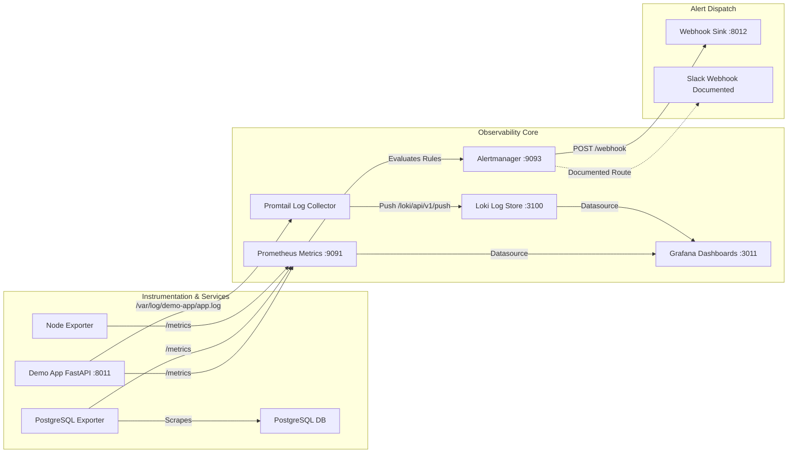

# Project: Monitoring & Alerting Dashboard

## 1. Problem Statement
Running a distributed automation and API stack requires deep visibility into service health, latency SLAs, error rates, and key business indicators. Without centralized observability, diagnosing production issues across microservices, databases, and background tasks is slow and reactive.

This project delivers a complete, autonomous, and production-grade observability stack featuring Prometheus metrics, Alertmanager alerting routes, Grafana visualization dashboards, and Loki/Promtail log aggregation, validated against an instrumented FastAPI application and synthetic traffic generator.

## 2. Tech Stack & Components
* **Metrics Database:** Prometheus `v3.2.1`
* **Dashboarding & Analytics:** Grafana `11.5.2`
* **Log Aggregation & Storage:** Loki `3.4.2`
* **Log Shipper:** Promtail `3.4.2`
* **Alert Router & Manager:** Alertmanager `v0.28.1`
* **Infrastructure Exporters:**
  * Node Exporter `v1.9.0` (host/system metrics)
  * PostgreSQL Exporter `v0.16.0` (relational database performance)
* **Application Services:**
  * Demo App (FastAPI `0.115.11` instrumented with `prometheus-client` and structured file/stream logging)
  * Webhook Sink (FastAPI local sink receiving real-time Alertmanager webhooks)
  * Load Generator (`load_generator.py` standalone traffic script)

## 3. Architecture


## 4. File Structure
```
11-monitoring-dashboard/
├── .env.example
├── .gitignore
├── docker-compose.yml
├── load_generator.py
├── pyproject.toml
├── requirements.txt
├── requirements-dev.txt
├── demo_app/
│   ├── Dockerfile
│   ├── __init__.py
│   ├── config.py
│   └── main.py
├── webhook_sink/
│   ├── Dockerfile
│   ├── __init__.py
│   └── sink.py
├── prometheus/
│   ├── alert.rules.yml
│   └── prometheus.yml
├── alertmanager/
│   └── alertmanager.yml
├── loki/
│   └── loki.yml
├── promtail/
│   └── promtail.yml
├── grafana/
│   └── provisioning/
│       ├── dashboards/
│       │   ├── dashboards.yml
│       │   └── json/
│       │       ├── negocio.json
│       │       └── servicios.json
│       └── datasources/
│           └── datasources.yml
└── tests/
    ├── __init__.py
    ├── test_demo_app.py
    ├── test_integration.py
    ├── test_load_generator.py
    ├── test_metrics.py
    └── test_webhook_sink.py
```

## 5. Port Allocations & Networking
Strictly mapped to localhost (`127.0.0.1`) without exposing internal databases to host:
* **Grafana:** `127.0.0.1:3011:3000`
* **Prometheus:** `127.0.0.1:9091:9090`
* **Alertmanager:** `127.0.0.1:9093:9093`
* **Demo App:** `127.0.0.1:8011:8000`
* **Webhook Sink:** `127.0.0.1:8012:5001`
* **Loki API:** `127.0.0.1:3100:3100`
* **PostgreSQL / Exporters:** Internal to `monitoring_net` bridge network only.

## 6. Monitored Metrics & Alert Rules

### Prometheus Scrape Jobs
* `prometheus`: Self-scraping health and scrape statistics.
* `demo-app`: Scrapes `/metrics` for SLA latency, status codes, and business processed rows.
* `postgres_exporter`: Scrapes database connections, active transactions, and commits.
* `node-exporter`: Scrapes host system CPU, memory, filesystem, and IO metrics.
* `alertmanager`: Scrapes notification delivery and route metrics.

### Alerting Rules (`prometheus/alert.rules.yml`)
1. **ServiceDown:** Triggers when `up{job="demo-app"} == 0` for > 10s (Severity: critical).
2. **HighErrorRate5xx:** Triggers when 5xx error rate exceeds 5% in a 1-minute window (Severity: critical).
3. **HighLatencyP95:** Triggers when 95th percentile latency exceeds 500ms (Severity: warning).
4. **HighDiskUsage:** Triggers when filesystem usage exceeds 85% (Severity: warning).
5. **PostgresDown:** Triggers when `pg_up == 0` for > 15s (Severity: critical).

## 7. Dashboards Provisioned
* **Servicios & Infraestructura (`servicios.json`):**
  * Target health status (UP/DOWN indicator)
  * HTTP request rate (req/sec by endpoint and status)
  * Latency quantiles (p95 and p50 timeseries)
  * 5xx error rate percentage
  * PostgreSQL active connections and committed transactions
  * Real-time stream of demo-app application logs from Loki
* **Negocio & KPIs (`negocio.json`):**
  * Total cumulative processed data rows
  * Current active business users gauge
  * Total operations executed breakdown
  * Processing velocity (rows/second rate by pipeline)
  * Operations distribution by business type

## 8. Verification & Execution

### Quality Gates & Unit Tests
```powershell
.venv\Scripts\ruff.exe check .
.venv\Scripts\pytest.exe -q
```

### Validate Prometheus & Alertmanager Configurations
```powershell
docker run --rm --entrypoint promtool -v "${PWD}/prometheus:/etc/prometheus" prom/prometheus:v3.2.1 check config /etc/prometheus/prometheus.yml
docker run --rm --entrypoint promtool -v "${PWD}/prometheus:/etc/prometheus" prom/prometheus:v3.2.1 check rules /etc/prometheus/alert.rules.yml
docker run --rm --entrypoint amtool -v "${PWD}/alertmanager:/etc/alertmanager" prom/alertmanager:v0.28.1 check-config /etc/alertmanager/alertmanager.yml
```

### Run Stack & Integration Suite
```powershell
docker compose up -d --build
docker compose ps
.venv\Scripts\python.exe load_generator.py --requests 25 --batches 5 --rows 100 --with-errors --with-slow
.venv\Scripts\pytest.exe -m integration -q
```

### Teardown
```powershell
docker compose down -v
```
