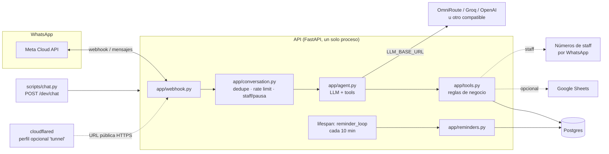

# Sabor de Casa — Asistente de WhatsApp para restaurantes

Asistente conversacional que atiende el WhatsApp de un restaurante 24/7: toma pedidos a
domicilio, agenda reservas, recoge datos de eventos grandes y, cuando no puede resolver algo,
pasa la conversación a una persona del equipo sin que el cliente tenga que repetir nada.

## 1. El problema

Un restaurante pequeño o mediano recibe decenas de mensajes de WhatsApp al día pidiendo el menú,
preguntando por domicilios, reservando mesa o cotizando un evento. Contestar uno por uno:

- hace perder pedidos fuera de horario de atención,
- satura al personal en las horas pico (justo cuando más se necesita vender),
- y es fácil que alguien se equivoque calculando un total o la cobertura de una zona.

Este proyecto resuelve eso con un bot que responde al instante, con las reglas del negocio
(precios, zonas, horarios, cupos) aplicadas siempre igual, y que avisa a una persona del equipo
en los casos que de verdad necesitan trato humano.

## 2. Qué hace el bot (escenarios cubiertos)

| Escenario | Qué pasa |
|---|---|
| **Pedido a domicilio** | El cliente arma su pedido en lenguaje natural, el bot valida el menú, la zona de cobertura, el pedido mínimo y el medio de pago, calcula el total (incluyendo domicilio) y lo guarda. |
| **Consultar un pedido** | El cliente pregunta por el estado de su pedido con el número; solo puede ver los suyos. |
| **Reserva de mesa** | El cliente pide mesa para una fecha/hora/número de personas; el bot valida horario, día (cerrado los lunes), cupo disponible y tamaño de grupo (hasta 12 personas). |
| **Modificar o cancelar una reserva** | El cliente puede cambiar fecha/hora/personas o cancelar, solo sobre sus propias reservas. |
| **Recordatorio de reserva** | Un día antes de la reserva, el bot envía un recordatorio por WhatsApp automáticamente. |
| **Evento grande (> 12 personas)** | El bot recoge tipo de evento, fecha, invitados, presupuesto y datos de contacto, y queda como una oportunidad (*lead*) para que el equipo comercial la cierre. |
| **Traspaso a una persona** | Si el cliente lo pide, o el bot falla dos veces seguidas respondiendo, la conversación pasa a una persona: el bot queda en silencio con ese cliente por 12 horas y el equipo recibe una notificación con el motivo y un resumen. |
| **Comandos del equipo** | Desde los números de staff: `/pedidos` (pedidos pendientes de hoy), `/bot <número>` (reactivar el bot con un cliente) y `/r <número> <texto>` (responder directamente al cliente). |

Lo que el bot **no** hace (a propósito, ver `docs/reviews/DECISIONES-13.md`): no reemplaza al
equipo en casos complejos, no gestiona pagos en línea, no tiene frontend ni base de datos
adicional (Celery/Redis/Mongo) — todo corre en un solo proceso Python + Postgres.

## 3. Capturas / demo

> 📸 *(placeholder) Captura de una conversación de pedido a domicilio completa.*
>
> 📸 *(placeholder) Captura de una reserva confirmada.*
>
> 🎞️ *(placeholder) GIF de 20-30s mostrando el traspaso a una persona.*

Guion completo de demo (2 minutos) en [`docs/DEMO-SCRIPT.md`](docs/DEMO-SCRIPT.md).

## 4. Arquitectura



- **`app/webhook.py`**: recibe los mensajes reales de WhatsApp (firma verificada con
  `WHATSAPP_APP_SECRET`).
- **`app/conversation.py`**: punto de entrada único — evita procesar un mensaje dos veces, aplica
  el límite de mensajes por cliente, detecta comandos de staff y si el bot está en pausa para ese
  cliente antes de llamar al agente.
- **`app/agent.py`**: arma el prompt (con contexto recuperado de `knowledge/`) y llama al LLM, que
  decide si responde texto o llama a una herramienta (`app/tools.py`).
- **`app/tools.py`**: toda la lógica de negocio (pedidos, reservas, eventos, traspaso) y las
  validaciones (zonas, horarios, cupos, topes de cantidad).
- **`app/reminders.py`**: tarea periódica (arrancada en el `lifespan` de `app/main.py`) que envía
  el recordatorio de reserva del día siguiente.
- **`app/sheets.py`**: sincronización opcional a Google Sheets (si no está configurada, no hace
  nada; si falla, solo queda en el log).
- **`cloudflared`** (perfil `tunnel` en `docker-compose.yml`): expone la API en una URL HTTPS
  pública para que Meta pueda llamar al webhook sin desplegar nada.

## 5. Correrlo en local (modo desarrollo, sin cuenta de WhatsApp)

Requisitos: Docker y Docker Compose.

```powershell
# 1. Copia el archivo de ejemplo y ajusta lo que necesites (claves de LLM, etc.)
Copy-Item .env.example .env

# 2. Levanta la base de datos y la API
docker compose --env-file .env up -d --build

# 3. Revisa que ambos contenedores estén healthy
docker compose ps
```

Con `DEV_MODE=true` (el valor por defecto en `.env.example`) queda disponible
`POST /dev/chat`, protegido con `DEV_API_KEY`, que corre exactamente la misma lógica que el
webhook real pero sin necesitar WhatsApp. Para chatear desde la terminal:

```powershell
$env:DEV_API_KEY = "el mismo valor que pusiste en .env"
python scripts/chat.py 573001234567
```

Para probar sin gastar llamadas reales al LLM, pon `LLM_FAKE=true` (solo pensado para pruebas):
el "mensaje del cliente" debe ser un JSON como
`{"tool": "create_order", "arguments": {...}}` y el bot "llama" esa herramienta directamente.

## 6. Conectarlo a un número real de WhatsApp (paso a paso)

Esta guía usa el **número de prueba gratuito** que da Meta — no necesitas comprar un número ni
verificar un negocio para probar el bot con hasta 5 destinatarios de prueba.

### 6.1 Crear la app en Meta for Developers

1. Entra a [developers.facebook.com](https://developers.facebook.com/) con una cuenta de
   Facebook, crea una cuenta de desarrollador si no tienes una.
2. **Mis apps → Crear app → tipo "Negocios"** (Business). Ponle un nombre cualquiera.
3. En el panel de la app, busca el producto **WhatsApp** y añádelo ("Set up").

### 6.2 Número de prueba y token temporal

1. En **WhatsApp → Primeros pasos (API Setup)**, Meta te da automáticamente:
   - un **número de prueba** (lo usa el bot para *enviar* mensajes),
   - un **`Phone number ID`** (cópialo: es `WHATSAPP_PHONE_NUMBER_ID`),
   - un **token de acceso temporal** (dura ~24h, sirve para probar rápido).
2. Para un token que no expire cada día, crea un **token permanente**: ve a
   **Configuración de la app → Usuarios del sistema**, crea un usuario de sistema, asígnale
   permisos sobre la app de WhatsApp y genera un token sin fecha de expiración. Ese es tu
   `WHATSAPP_TOKEN`.
3. En **Configuración de la app → Básica**, copia el **App Secret** (botón "Mostrar"): es tu
   `WHATSAPP_APP_SECRET`, se usa para verificar que los webhooks realmente vienen de Meta.

### 6.3 Agregar destinatarios de prueba

En **WhatsApp → Primeros pasos**, en la sección "Hacia", puedes añadir hasta **5 números de
teléfono de prueba** (los tuyos o los de tu equipo). Cada número debe aceptar una invitación por
WhatsApp antes de poder recibir mensajes del bot.

### 6.4 Exponer tu API local con cloudflared (sin desplegar nada)

Meta necesita una URL **HTTPS pública** para mandarte los webhooks. `docker-compose.yml` ya trae
un perfil `tunnel` con `cloudflared` para esto:

```powershell
docker compose --env-file .env --profile tunnel up -d cloudflared
docker compose logs cloudflared
```

En los logs aparece una URL del estilo `https://algo-al-azar.trycloudflare.com` — esa es tu URL
pública temporal (apunta al contenedor `api`, puerto 8000).

### 6.5 Configurar el webhook en Meta

1. Define un **`WHATSAPP_VERIFY_TOKEN`** propio (cualquier texto que tú inventes) y ponlo también
   en tu `.env`.
2. En **WhatsApp → Configuración**, pega:
   - **URL de devolución de llamada**: `https://<tu-url-de-cloudflared>/webhook`
   - **Verify token**: el mismo valor que pusiste en `WHATSAPP_VERIFY_TOKEN`
3. Haz clic en **Verificar y guardar** (Meta llamará a tu webhook con un `GET`; si todo coincide,
   queda verificado).
4. En **Campos del webhook**, suscríbete a **`messages`** (es el único campo que necesita el bot).

### 6.6 Completar tu `.env` y levantar todo con WhatsApp activado

```env
WHATSAPP_ENABLED=true
WHATSAPP_TOKEN=<tu token permanente>
WHATSAPP_PHONE_NUMBER_ID=<tu phone number id>
WHATSAPP_APP_SECRET=<tu app secret>
WHATSAPP_VERIFY_TOKEN=<el que inventaste>
```

```powershell
docker compose --env-file .env up -d --build
```

Desde uno de los 5 números de prueba que agregaste, escríbele al número de prueba de Meta — el
mensaje debería llegar al webhook y el bot debería responder.

### 6.7 Apuntar el LLM a OmniRoute, Groq u OpenAI

El bot habla con cualquier proveedor compatible con la API de OpenAI (`chat.completions` con
`tools`). Solo cambia estas tres variables:

| Proveedor | `LLM_BASE_URL` | `LLM_MODEL` (ejemplo) |
|---|---|---|
| Groq | `https://api.groq.com/openai/v1` | `llama-3.3-70b-versatile` |
| OpenAI | `https://api.openai.com/v1` | `gpt-4o-mini` |
| OmniRoute (u otro proxy compatible) | la URL de tu proxy | el modelo que tengas configurado ahí |

`LLM_API_KEY` es la clave de ese proveedor. Nunca la escribas en el README ni en el repositorio:
solo en tu `.env` local (que está en `.gitignore`).

## 7. Google Sheets (opcional)

Si configuras `GOOGLE_SERVICE_ACCOUNT_JSON` (el JSON de una cuenta de servicio de Google con
acceso a Sheets) y `GOOGLE_SHEET_ID`, cada pedido, reserva y *lead* de evento se agrega también a
una pestaña ("Pedidos", "Reservas", "Eventos") de esa hoja de cálculo. Si falla (credenciales
mal puestas, hoja no compartida, límite de la API), el bot sigue funcionando normal — solo queda
un log de error.

## 8. Pruebas y calidad

```powershell
.venv\Scripts\ruff.exe check app tests
.venv\Scripts\ruff.exe format --check app tests
.venv\Scripts\mypy.exe app
.venv\Scripts\python.exe -m pytest --timeout=60 --cov -p no:cacheprovider
```

Las pruebas de integración/E2E (`pytest -m "integration or e2e"`) necesitan el stack de Docker
levantado y están excluidas por defecto; ver
[`docs/reviews/T-13-lote-c.md`](docs/reviews/T-13-lote-c.md) para la salida real de la última
corrida.
