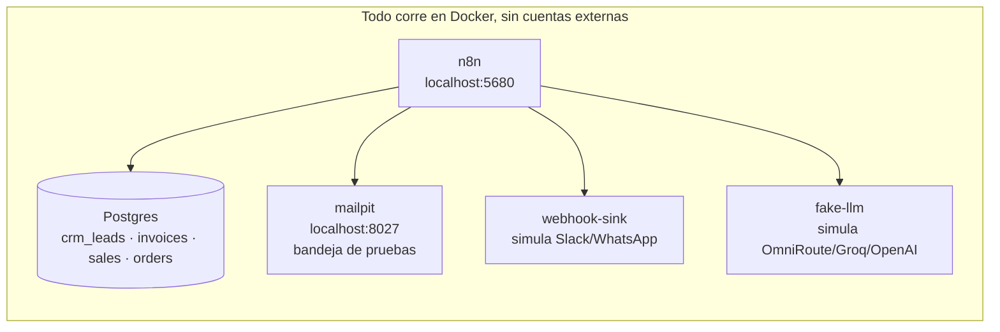
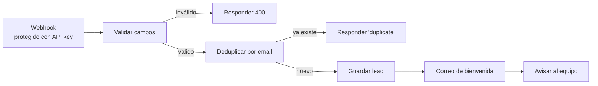
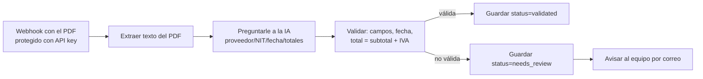
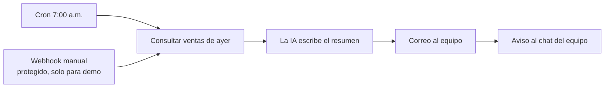
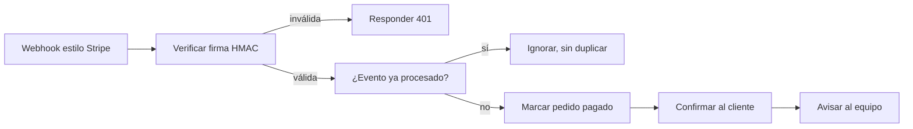

# Sabor de Casa — Paquete de automatizaciones n8n

Cuatro automatizaciones listas para un restaurante (o cualquier negocio con el mismo patrón:
formulario web, facturas de proveedores, reporte de ventas y pagos en línea), construidas en
[n8n](https://n8n.io) — la misma herramienta visual de "cajitas conectadas" que usan agencias y
freelancers de automatización. Todo corre **en tu computador, sin ninguna cuenta externa**, para
que puedas verlo funcionar antes de conectarlo a tus sistemas reales (HubSpot, Google Sheets,
Gmail, Stripe/Wompi, WhatsApp).

## 1. El problema

En un restaurante pequeño o mediano, estas cuatro tareas se hacen a mano, todos los días:

- alguien copia a mano los datos de cada formulario de "cotizar un evento" a una hoja o al CRM,
- alguien digita cada factura de proveedor (verduras, carnes, bebidas) para llevar la contabilidad,
- alguien arma a mano, cada mañana, el resumen de ventas del día anterior para el equipo,
- alguien revisa uno por uno los pagos que llegan para marcar manualmente qué pedido ya se pagó.

Cada una de esas tareas es repetitiva, se presta a errores de digitación y le quita tiempo a
alguien que podría estar atendiendo el restaurante. Las cuatro automatizaciones de este paquete
hacen ese trabajo solas, de forma consistente, y avisan a una persona solo cuando algo de verdad
necesita criterio humano.

## 2. Qué automatiza cada flujo

| Flujo | Qué hace | Tiempo que ahorra |
|---|---|---|
| **F1** Lead de formulario → CRM | Alguien llena el formulario de "cotizar un evento" de la página web → se valida, se revisa que no sea un lead repetido, se guarda, se le manda un correo de bienvenida y se avisa al equipo. | ~5 min por lead, y ninguno se pierde por olvido. |
| **F2** Factura de proveedor → datos | Llega una factura en PDF (como un adjunto de correo) → se lee el texto, una IA extrae proveedor/NIT/fecha/subtotal/IVA/total/ítems, se valida que los números cuadren y la fecha sea real, y se guarda. Si algo no cuadra, queda marcada para revisión humana en vez de guardarse mal. | ~10-15 min de digitación por factura. |
| **F3** Reporte diario de ventas con IA | Todos los días a las 7:00 a.m. (hora Colombia), consulta las ventas de ayer, una IA escribe un resumen en español, y lo manda por correo y al chat del equipo. | ~15 min diarios armando el resumen a mano. |
| **F4** Pago recibido → pedido | Llega la notificación de pago (estilo Stripe/Wompi) → se verifica que la firma sea auténtica, se revisa que ese pago no se haya procesado antes (por si el proveedor reintenta el aviso), se marca el pedido como pagado y se le confirma al cliente. | Evita el "pagó pero quedó como pendiente" y el doble cobro por reintentos. |

Lo que este paquete **no** hace (a propósito): no sustituye
al equipo en decisiones de negocio (precios, excepciones, atención al cliente difícil), no tiene
su propio frontend — todo se opera desde la interfaz de n8n o desde los sistemas que ya usa el
negocio (CRM, correo, Sheets) una vez puesto en producción.

## 3. Capturas / demo

> *(placeholder) Captura del lienzo de n8n con los 4 flujos activos.*
>
> *(placeholder) Captura de un correo de bienvenida en la bandeja de "equipo" (mailpit).*
>
> *(placeholder) GIF de 2 min mostrando los 4 flujos, ver `docs/DEMO-SCRIPT.md`.*

Guion completo de demo (2 minutos) en [`docs/DEMO-SCRIPT.md`](docs/DEMO-SCRIPT.md).

## 4. Arquitectura



Cada flujo es independiente dentro de la misma instancia de n8n, y los cuatro comparten un
"manejador de errores" (`Shared Error Handler`): si algo falla en cualquier flujo, queda
registrado en la tabla `workflow_errors` y le llega un correo al equipo, sin exponer datos
sensibles.

### F1 — Lead de formulario a CRM



### F2 — Factura PDF a datos



### F3 — Reporte diario con IA



### F4 — Pago recibido a pedido



## 5. Cómo correrlo en local

Requisitos: Docker y Docker Compose.

```powershell
# 1. Levanta todo (postgres, n8n, mailpit, webhook-sink, fake-llm) e importa/activa los 4 flujos
docker compose --env-file .env.example up -d --build --wait

# 2. Revisa que todo esté healthy
docker compose ps
```

No necesitas crear ningún archivo `.env`: `n8n-init` arma las credenciales de Postgres, SMTP y
los API keys de los webhooks directamente desde `.env.example` la primera vez que levantas el
stack (nunca con secretos reales — todo son placeholders `change_me_...`).

- **n8n** (lienzo/editor de los flujos): http://localhost:5680
- **mailpit** (bandeja de correo de pruebas — aquí llegan los correos que "enviarían" los flujos):
  http://localhost:8027

Para probar cada flujo sin usar la interfaz:

```powershell
# F1 — nuevo lead
curl -X POST http://localhost:5680/webhook/lead-form -H "X-Api-Key: change_me_webhook_api_key" -H "Content-Type: application/json" -d '{"name":"Ana Gomez","email":"ana@example.com","event_type":"matrimonio","guests":40}'

# F2 — factura de ejemplo (ver samples/)
curl -X POST http://localhost:5680/webhook/invoice-upload -H "X-Api-Key: change_me_webhook_api_key" -H "Content-Type: application/pdf" --data-binary "@samples/factura-valida.pdf"

# F3 — generar el reporte de ventas ahora mismo (en vez de esperar a las 7am); "date" es
# opcional (YYYY-MM-DD, por defecto "ayer") — 2025-01-15 es la fecha fija de ejemplo sembrada
# en init-db.sql, para que la demo tenga datos sin importar qué día se corra
curl -X POST http://localhost:5680/webhook/daily-report-trigger -H "X-Api-Key: change_me_webhook_api_key" -H "Content-Type: application/json" -d '{"date":"2025-01-15"}'

# F4 — necesita la firma HMAC, ver docs/DEMO-SCRIPT.md para el paso a paso
```

Después de cada prueba, revisa http://localhost:8027 para ver el correo "enviado".

## 6. Cómo pasar cada flujo a producción

Nada de esto requiere rehacer el flujo: en n8n cambias el nodo de destino y la credencial, el
resto (validaciones, deduplicación, manejo de errores) queda igual.

| Flujo | En local | En producción |
|---|---|---|
| F1 | Guarda en Postgres, correo con mailpit, aviso con `webhook-sink` | Nodo de HubSpot o Airtable en vez del nodo Postgres; credencial SMTP real; `webhook-sink` → Slack/WhatsApp |
| F2 | Webhook simula "factura recibida"; IA es `fake-llm` | Disparador por Gmail/IMAP (nodo nativo de n8n) en vez del webhook; destino en Google Sheets en vez de Postgres |
| F3 | Cron + webhook manual; guarda/lee de Postgres | Nodo de Sheets o la base del cliente; correo y Slack reales |
| F4 | Webhook con firma HMAC propia | Webhook real de Stripe o Wompi (misma verificación de firma); confirmación al cliente por WhatsApp Cloud API |

**La IA (F2 y F3)** no necesita rediseñar el flujo: cambia `LLM_BASE_URL`, `LLM_MODEL` y
`LLM_API_KEY` en `.env`/tu entorno para apuntar a OmniRoute, Groq u OpenAI (cualquier endpoint
compatible con `POST /v1/chat/completions`), y pones la clave real en la credencial
**"LLM API Key"**. A diferencia de las credenciales, estos dos valores quedan grabados dentro del
JSON de cada workflow al importarlo (`n8n-init` los sustituye una sola vez, nunca se leen con
`$env` dentro de n8n — así una expresión o Code node de cualquier flujo no puede leer variables
sensibles del contenedor como `N8N_ENCRYPTION_KEY`), así que cambiar de proveedor en producción
necesita volver a correr `n8n-init` (reimportar F2/F3), no solo reiniciar `n8n`.

| Proveedor | `LLM_BASE_URL` | `LLM_MODEL` (ejemplo) |
|---|---|---|
| Groq | `https://api.groq.com/openai/v1` | `llama-3.3-70b-versatile` |
| OpenAI | `https://api.openai.com/v1` | `gpt-4o-mini` |
| OmniRoute (u otro proxy compatible) | la URL de tu proxy | el modelo que tengas configurado ahí |

## 7. Cómo importar esto en una instancia n8n ya existente del cliente

1. En n8n, ve a **Workflows → Import from File** y sube cada archivo de `workflows/*.json` (puedes
   dejar fuera el que no necesites).
2. Crea a mano las credenciales que cada flujo espera encontrar (mismo **nombre**, el id lo
   reasigna n8n solo al importar):
   - **Postgres - Sabor de Casa** (o la base de datos del cliente),
   - **Mailpit SMTP** → cámbiala por el SMTP real del cliente,
   - **Webhook API Key** (Header Auth, `X-Api-Key`) → genera una clave nueva,
   - **Payment Webhook HMAC** (Crypto, HMAC) → el secreto que dé el proveedor de pagos,
   - **LLM API Key** (Header Auth, `Authorization: Bearer ...`) → la clave real del proveedor de IA.
3. Reemplaza en cada flujo el nodo que apunta a Postgres/mailpit/`webhook-sink` por el nodo real
   (HubSpot, Sheets, Slack, etc., según la tabla de la sección 6).
4. Activa cada workflow.

## 8. Seguridad

- Los tres webhooks de entrada (F1, F2, F3 manual) exigen un `X-Api-Key` válido (Header Auth); sin
  él, n8n rechaza la petición antes de ejecutar nada.
- F4 verifica la firma `X-Signature: sha256=...` con comparación en tiempo constante
  (`crypto.timingSafeEqual`) para no filtrar el secreto por cuánto tarda la respuesta.
- Ningún archivo del repo tiene secretos reales: `credentials/*.json` y `workflows/*.json` son
  plantillas con `${VARIABLE}`, resueltas una sola vez al levantar el stack desde `.env.example`
  (`change_me_...`). Para producción, usa tu propio `.env` (nunca se versiona) con valores reales.
- `n8n` corre con `N8N_BLOCK_ENV_ACCESS_IN_NODE` en su valor seguro por defecto (los nodos no
  pueden leer `$env`): ese mismo contenedor también tiene `N8N_ENCRYPTION_KEY` y
  `DB_POSTGRESDB_PASSWORD` en su entorno, así que una expresión o Code node de cualquier flujo
  podría leerlos si se desactivara esa protección.

## 9. Pruebas y calidad

```powershell
.venv\Scripts\python.exe -m pytest -q                 # unitarias, no necesitan Docker
.venv\Scripts\python.exe -m pytest -q -m integration   # contra el stack real, ver sección 5
.venv\Scripts\ruff.exe check .
```

