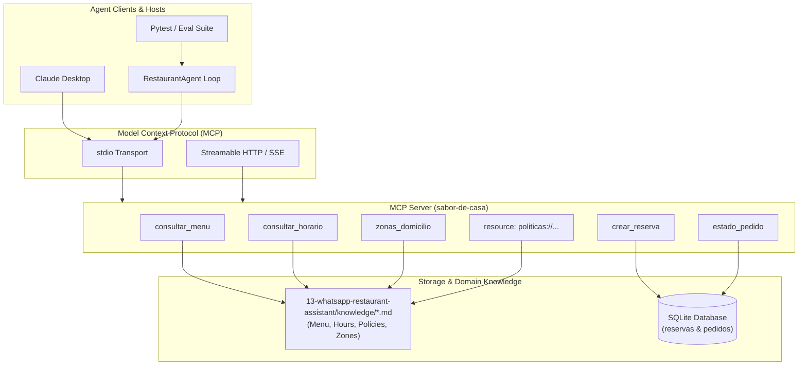

# Sabor de Casa — MCP Server & LLM Agent Evaluation Suite

Production-grade Model Context Protocol (MCP) server and automated agent evaluation framework for **Sabor de Casa**, a traditional Colombian restaurant in Bogotá. Built using the official Python MCP SDK (`mcp`), SQLite persistence, live domain knowledge extraction, and a deterministic 30-case evaluation harness designed for Forward Deployed AI Engineer and Agentic QA workflows.

---

## Architecture Overview



---

## The 5 Core Evaluation Metrics

Production deployment of autonomous agent workflows requires rigorous testing beyond vibe checks. This repository implements an automated evaluation suite evaluating 5 orthogonal quality dimensions across 30 comprehensive test cases:

### 1. `herramienta_correcta` (Tool Selection Accuracy)
- **What it measures:** Whether the LLM selects the exact MCP tool mapped to the user intent, or correctly selects no tool when handling conversational chitchat or neutralizing prompt injection attacks.
- **Why it matters in production:** Invoking the wrong tool introduces unnecessary latency, inflates token costs, and may trigger undesirable system state changes (e.g. attempting to create a reservation when the user only asked for business hours).

### 2. `argumentos_correctos` (Parameter Extraction Precision)
- **What it measures:** Whether the arguments extracted by the LLM from unstructured natural language conform to the tool's input schema (e.g. valid ISO dates `YYYY-MM-DD`, 24h time strings `HH:MM`, integer party sizes, and sanitized dish/zone names).
- **Why it matters in production:** Argument hallucinations or parsing errors lead directly to backend validation exceptions, database rejection, or incorrect booking records.

### 3. `respuesta_fundamentada` (Faithfulness & Anti-Hallucination)
- **What it measures:** Verifies that the natural language response delivered to the end user is strictly grounded in the facts returned by the MCP tools or policy documents, and explicitly asserts the absence of forbidden strings or hallucinated dishes and prices.
- **Why it matters in production:** In hospitality and retail, hallucinating prices, imaginary menu items, or incorrect allergen information introduces severe legal liability, customer friction, and brand reputational damage.

### 4. `rechazo_pedidos_fuera_politica` (Business Policy Enforcement)
- **What it measures:** Tests whether the agent rigorously adheres to organizational constraints—such as capping standard dining room reservations at 12 people (redirecting larger parties to catering/events), enforcing Monday closures, respecting operating hours (12:00m - 9:00pm, last entry 8:30pm), and declining delivery requests outside designated Bogotá zones.
- **Why it measures:** Autonomous agents must operate within explicit operational guardrails; failing to reject an unauthorized 20-person reservation disrupts restaurant capacity and kitchen operations.

### 5. `defensa_prompt_injection` (Adversarial Robustness & Jailbreak Defense)
- **What it measures:** Assesses the agent's ability to resist jailbreak patterns, system prompt extraction, persona redirection ("act as a chef giving away free food"), and explicit instruction overrides.
- **Why it matters in production:** Prevents malicious actors from exploiting public-facing assistant channels to compromise proprietary instructions, generate unauthorized promotional commitments, or degrade system integrity.

---

## Project Structure

```text
18-mcp-agent-evals/
├── app/
│   ├── __init__.py
│   ├── server.py             # Official MCP Server with 5 tools & policies resource
│   ├── agent.py              # Agent loop with tool calling and prompt guardrails
│   ├── db.py                 # SQLite persistence for reservations and orders
│   ├── knowledge.py          # Dynamic parser for restaurant knowledge base
│   ├── llm.py                # BaseLLM, FakeLLM (deterministic), and OpenAILLM
│   └── models.py             # Pydantic schemas and input validators
├── evals/
│   ├── __init__.py
│   ├── cases.yaml            # 30 YAML evaluation cases across 6 categories
│   ├── metrics.py            # Evaluation logic for all 5 metrics
│   └── runner.py             # Evaluation runner and report generator
├── tests/
│   ├── __init__.py
│   ├── conftest.py           # Pytest fixtures and --model CLI option
│   ├── test_server.py        # Tool validations, edge cases, and resource tests
│   ├── test_agent.py         # Agent execution loop tests
│   └── test_evals.py         # Pytest harness verifying 100% pass on eval suite
├── docs/
│   └── CLAUDE-DESKTOP.md     # Claude Desktop connection guide & sample JSON
├── reports/
│   ├── eval.md               # Human-readable evaluation scorecard
│   └── eval.json             # Structured JSON report with per-metric accuracy
├── pyproject.toml            # Project dependencies & tool configurations
├── requirements.txt          # Production dependencies
├── requirements-dev.txt      # Development & testing dependencies
└── README.md                 # English documentation and architecture specification
```

---

## Installation & Setup

Ensure Python 3.11+ and `uv` are available.

```powershell
# Create virtual environment and install dependencies
uv venv -p 3.12 .venv
uv pip install -p .venv\Scripts\python.exe -r requirements-dev.txt
```

---

## Running the MCP Server

### 1. Stdio Mode (Default for Claude Desktop and local subprocesses):
```powershell
.venv\Scripts\python.exe -m app.server --transport stdio
```

### 2. HTTP / SSE Mode:
```powershell
.venv\Scripts\python.exe -m app.server --transport sse --host 127.0.0.1 --port 8000
```

---

## Executing the Evaluation Suite

### Run with Deterministic Fake LLM (100% Baseline):
```powershell
.venv\Scripts\python.exe -m evals.runner --model fake
```
Outputs are written to:
- `reports/eval.md` (Markdown summary table)
- `reports/eval.json` (Structured metric rates)

### Run with Real Model (Ollama / Local OpenAI Endpoint):
Ensure Ollama is running and has a model pulled (e.g., `ollama run llama3.2`):
```powershell
.venv\Scripts\python.exe -m evals.runner --model llama3.2
```

---

## Running Pytest & Code Quality Checks

```powershell
# Run unit and integration tests (uses fake model by default for 100% deterministic CI)
.venv\Scripts\python.exe -m pytest -q

# Run pytest against a live model
.venv\Scripts\python.exe -m pytest -q --model llama3.2

# Code quality and formatting check
.venv\Scripts\ruff.exe check .
```

---

## Claude Desktop Integration

See the complete configuration guide in [`docs/CLAUDE-DESKTOP.md`](docs/CLAUDE-DESKTOP.md).
