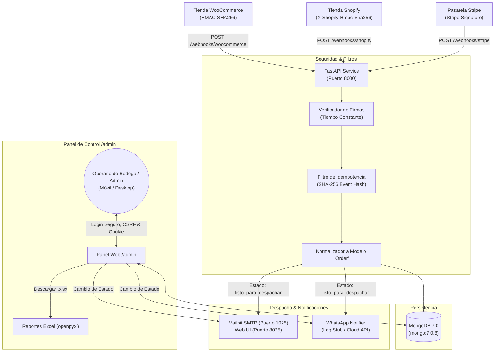

# Café de Origen · Automatización Integral de Pedidos E-commerce

> Solución profesional de automatización de fulfillment multicanal que unifica pedidos y pagos de **WooCommerce**, **Shopify** y **Stripe** en un único pipeline con persistencia en **MongoDB**, notificaciones automáticas (Email y WhatsApp) y panel administrativo seguro para bodega y despachos.

---

## 🌟 Valor de Negocio

Para tiendas que venden en múltiples plataformas y canales online, la gestión manual de despachos genera errores humanos, pedidos duplicados, demoras en bodega y clientes desinformados.

Este producto resuelve esos problemas mediante:
1. **Unificación Inmediata:** Convierte payloads dispares de WooCommerce, Shopify y Stripe a un modelo único de datos.
2. **Seguridad Criptográfica:** Valida las firmas digitales de cada plataforma (HMAC-SHA256 en Base64 para WooCommerce y Shopify; `Stripe-Signature` con tolerancia de tiempo de 300s para Stripe). Las solicitudes no autorizadas son rechazadas al instante.
3. **Idempotencia Garantizada:** Registro de hashes SHA-256 e identificadores de eventos para evitar duplicar órdenes si la pasarela reenvía un webhook.
4. **Notificaciones Multicanal:** Al confirmarse el pago, el pedido pasa a `"listo para despachar"`, enviando automáticamente un correo de confirmación (vía SMTP / Mailpit) y una alerta por WhatsApp (interfaz intercambiable con Stub para demo y conector a WhatsApp Cloud API).
5. **Panel Administrativo `/admin`:** Interfaz web responsive (óptima para celular en bodega), protegida con hash seguro PBKDF2, cookies `HttpOnly`, tokens CSRF y bloqueo automático tras 5 intentos fallidos de autenticación. Permite filtrar, cambiar estados (`listo_para_despachar` &rarr; `despachado` &rarr; `entregado`) y exportar reportes en Microsoft Excel (`.xlsx`).

---

## 📐 Arquitectura del Sistema



---

## ☕ Catálogo de Demostración ("Café de Origen")

El sistema incluye un catálogo de 10 cafés especiales colombianos de muestra, claramente identificados como ficticios con propósitos de demostración:
- **Café Huila Especial (250g)** · Notas a panela y cítricos dulces ($28.000 COP).
- **Café Nariño Supremo (250g)** · Acidez brillante y caramelo ($30.000 COP).
- **Café Geisha Sierra Nevada (250g)** · Varietal exótico, jazmín y miel ($55.000 COP).
- **Café Bourbon Rosado Quindío (250g)** · Proceso anaeróbico, frutos rojos ($45.000 COP).
- **Café Tolima Orgánico (500g)** · Certificado orgánico bajo sombra ($42.000 COP).
- **Café Antioquia Tradicional (500g)** · Balance tradicional de montaña paisa ($38.000 COP).
- **Café Descafeinado Caña de Azúcar (250g)** · Proceso natural Sugar Cane ($32.000 COP).
- **Edición Especial Cosecha Tardía (250g)** · Dulzor denso y licor de cereza ($48.000 COP).
- **Cold Brew Blend Especial (1000g)** · Molienda gruesa para maceración ($75.000 COP).
- **Prensa Francesa + Café Huila Pack Regalo** · Pack completo con cafetera ($95.000 COP).

---

## 🚀 Puesta en Marcha Rápida con Docker Compose

La aplicación se distribuye completamente dockerizada con imágenes de versiones fijas y comprobaciones de salud (`healthchecks`):

```bash
# 1. Clonar el repositorio y entrar a la carpeta
cd 20-ecommerce-order-automation

# 2. Configurar variables de entorno desde el ejemplo
copy .env.example .env

# 3. Levantar la pila completa (API + MongoDB + Mailpit)
docker compose up -d --build
```

### Servicios Disponibles:
- **API y Panel de Control:** [http://localhost:8000/admin](http://localhost:8000/admin)
  - Usuario por defecto: `admin`
  - Contraseña por defecto: `change_me_admin_password`
- **Servidor de Correos (Mailpit Web):** [http://localhost:8025](http://localhost:8025)
- **Base de Datos MongoDB:** `localhost:27017`

Para detener los servicios:
```bash
docker compose down
```

---

## 💻 Desarrollo Local y Ejecución de Pruebas

Si prefieres ejecutar el proyecto localmente con Python 3.12:

```bash
# Crear entorno virtual e instalar dependencias
uv venv -p 3.12 .venv
.venv\Scripts\activate
uv pip install -r requirements-dev.txt

# Ejecutar el conjunto de pruebas unitarias
.venv\Scripts\pytest.exe -q

# Verificar calidad de código con ruff
.venv\Scripts\ruff.exe check .
```

---

## 🧪 Demostración con Webhooks de Muestra (`samples/`)

El directorio `samples/` contiene cargas útiles (`payloads`) reales de cada plataforma y un script automatizado para firmar y enviar pedidos de prueba:

```bash
# Asegúrate de que el servidor esté corriendo en http://localhost:8000
.venv\Scripts\python.exe samples/send_webhooks.py
```

El script ejecutará automáticamente 5 pasos:
1. Envío de orden de **WooCommerce** &rarr; Código 200 `processed`.
2. Envío de orden de **Shopify** &rarr; Código 200 `processed`.
3. Envío de pago de **Stripe** &rarr; Código 200 `processed`.
4. Prueba de **Idempotencia** (reenvío del mismo pedido) &rarr; Código 200 `ignored (duplicate_event)`.
5. Prueba de **Seguridad** (firma alterada/inválida) &rarr; Código 401 `Unauthorized`.

Revisa de inmediato el panel en [http://localhost:8000/admin](http://localhost:8000/admin) y los correos recibidos en [http://localhost:8025](http://localhost:8025).

---

## 🔒 Consideraciones de Seguridad

- **Cero Secretos en el Repositorio:** El archivo `.env` está en `.gitignore`. Solo se versiona `.env.example` con marcadores `change_me_<nombre>`.
- **Mitigación de Ataques de Fuerza Bruta:** Tras 5 intentos fallidos consecutivos de inicio de sesión, el usuario o dirección IP queda bloqueado por 15 minutos (código HTTP 429).
- **Protección CSRF:** Cada formulario administrativo incluye un token CSRF criptográficamente firmado y validado en tiempo constante.
- **Sesión Segura:** Cookies con flags `HttpOnly`, `SameSite=Lax` y firma HMAC-SHA256 con expiración de 24 horas.

---

## 📚 Documentación Adicional

- [Guión de Demostración para Clientes (5 Minutos)](docs/DEMO-SCRIPT.md)
- [Guía para Crear Cuentas Gratuitas de Prueba en Shopify y Stripe](docs/CUENTAS.md)
