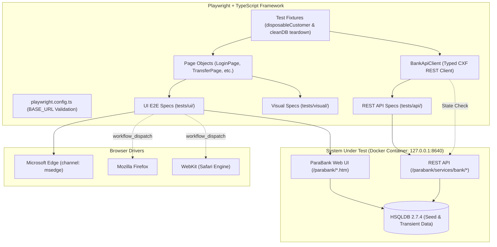

# ParaBank Automated Quality Engineering Framework

> Enterprise-grade End-to-End, API, and Visual Regression testing framework built with **Playwright Test** and **TypeScript** (Strict Mode) against the **ParaBank** banking system.

[](https://playwright.dev/)
[](https://www.typescriptlang.org/)
[](https://nodejs.org/)
[](https://playwright.dev/docs/browsers)
[](LICENSE)

---

## 1. What Exists Today

This repository delivers an automated testing suite designed according to modern Software Quality Engineering standards.

Key highlights:

- **Strict TypeScript Architecture:** Zero untyped variables (`strict: true`, ESLint + Prettier enforcement).
- **Targeted Browser Matrix:** Primary focus on **Microsoft Edge** (`channel: 'msedge'`) with cross-browser support for **Mozilla Firefox** and **WebKit**. Chrome/Chromium are disallowed per project policy.
- **Hybrid UI + API Verification:** A hybrid test executes funds transfer through the user interface and immediately validates the resulting balances directly via ParaBank's REST API, preventing UI masking of backend calculation defects.
- **Disposable Customer Fixture:** Automated lifecycle generating unique dynamic accounts for tests, followed by verified cleanup via `/cleanDB` asserting the user has been purged.
- **Visual Regression Testing:** Snapshot comparison on the primary login interface using `toHaveScreenshot()`.
- **Zero Sleep Policy:** No static pauses (`page.waitForTimeout` / `setTimeout`). All tests synchronize on explicit DOM states, network responses, and API state assertions.

---

## 2. Test Coverage: Designed vs. Automated

| Functional Area                        | Scenarios Designed | Scenarios Automated | Coverage (%) | Automated Test Spec                                                                       |
| -------------------------------------- | :----------------: | :-----------------: | :----------: | ----------------------------------------------------------------------------------------- |
| **Authentication & Registration**      |         10         |          5          |     50%      | `tests/ui/auth.spec.ts`                                                                   |
| **Accounts & Overview**                |         7          |          3          |     43%      | `tests/ui/accounts.spec.ts`                                                               |
| **Transfers & Balance Reconciliation** |         5          |          2          |     40%      | `tests/ui/transfers.spec.ts`                                                              |
| **Bill Pay Services**                  |         4          |          1          |     25%      | `tests/ui/billpay.spec.ts`                                                                |
| **Loan Applications**                  |         4          |          1          |     25%      | `tests/ui/loan.spec.ts`                                                                   |
| **Find Transactions**                  |         5          |          1          |     20%      | `tests/ui/accounts.spec.ts`                                                               |
| **Customer Profile**                   |         3          |          1          |     33%      | `tests/ui/profile.spec.ts`                                                                |
| **REST API & DB Lifecycle**            |         10         |         10          |     100%     | `tests/api/accounts.spec.ts`, `tests/api/transactions.spec.ts`, `tests/api/admin.spec.ts` |
| **Visual Regression**                  |         1          |          1          |     100%     | `tests/visual/login.spec.ts`                                                              |
| **Total**                              |       **49**       |       **25**        |   **51%**    | **Full Suite**                                                                            |

_Detailed scenario breakdown and priorities can be found in [`docs/TEST-SCENARIOS.md`](docs/TEST-SCENARIOS.md) and [`docs/TRACEABILITY-MATRIX.md`](docs/TRACEABILITY-MATRIX.md)._

---

## 3. Architecture Overview (Target Architecture)



---

## 4. Prerequisites & Environment Variables

### Prerequisites

- **Node.js:** v24.x or higher
- **Docker & Docker Compose:** Required to run the local ParaBank service
- **Microsoft Edge:** Installed locally for UI execution

### Environment Variables

The framework loads variables from `.env`. See `.env.example`:

| Variable   | Default Value                    | Description                                                                   |
| ---------- | -------------------------------- | ----------------------------------------------------------------------------- |
| `BASE_URL` | `http://127.0.0.1:8640/parabank` | Base URL of the ParaBank web application (must be a valid `http`/`https` URL) |

---

## 5. Local Setup & Execution Guide

### 1. Install Dependencies

```bash
npm ci
```

### 2. Start ParaBank SUT

```bash
docker compose up -d --wait
```

_Note: The container healthcheck ensures that database tables and seed parameters are initialized before marking the service healthy._

### 3. Run Quality Gates

```bash
npm run lint
npm run format:check
npm run typecheck
```

### 4. Run Test Suites

```bash
# Run default test suite (Edge UI + API)
npm test

# Run only REST API tests
npm run test:api

# Run only UI tests (Edge)
npm run test:ui

# Run Smoke tests
npm run test:smoke

# Run Regression tests
npm run test:regression

# Run Full Cross-Browser Suite (Edge + Firefox + WebKit)
npm run test:cross-browser
```

### 5. Tear Down SUT

```bash
docker compose down -v
```

---

## 6. Available NPM Scripts

| Script               | Command                                                             | Purpose                                                |
| -------------------- | ------------------------------------------------------------------- | ------------------------------------------------------ |
| `test`               | `playwright test --project=edge`                                    | Runs default UI (Edge) and core tests                  |
| `test:api`           | `playwright test --project=api`                                     | Runs headless REST API test suite                      |
| `test:ui`            | `playwright test --project=edge`                                    | Runs full UI suite on Microsoft Edge                   |
| `test:smoke`         | `playwright test --grep @smoke`                                     | Runs all `@smoke` tagged tests                         |
| `test:regression`    | `playwright test --grep @regression`                                | Runs all `@regression` tagged tests                    |
| `test:cross-browser` | `playwright test --project=edge --project=firefox --project=webkit` | Runs cross-browser matrix across Edge, Firefox, WebKit |
| `lint`               | `eslint "src/**/*.ts" "tests/**/*.ts" "playwright.config.ts"`       | Lints code with ESLint and TypeScript rules            |
| `format:check`       | `prettier --check "**/*.{ts,json,md,yml,yaml}"`                     | Checks formatting compliance                           |
| `typecheck`          | `tsc --noEmit`                                                      | Compiles TypeScript in strict mode without output      |

---

## 7. CI/CD Policy (GitHub Actions)

Workflow file: [`.github/workflows/24-playwright-ts-parabank.yml`](../../.github/workflows/24-playwright-ts-parabank.yml)

- **Push Policy:** Triggered on changes to `24-playwright-ts-parabank/**` or the workflow itself. Runs `lint`, `typecheck`, `test:api`, and `test:ui` (Edge) to provide rapid feedback (< 2 minutes).
- **Manual Policy (`workflow_dispatch`):** Executes full cross-browser testing across Edge, Firefox, and WebKit.
- **Reporting:** Generates the official Playwright HTML report and uploads it as an action artifact.
