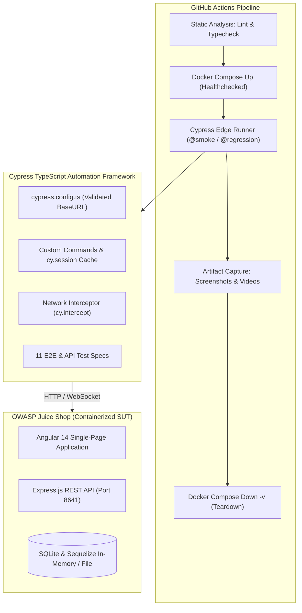

# 26 · Cypress + TypeScript Automation Suite over OWASP Juice Shop

[](https://github.com/valarcon1226/IBM-Agentric-IA-labs/actions/workflows/26-cypress-juice-shop.yml)
[](https://nodejs.org/)
[](https://www.cypress.io/)
[-blue.svg>)](https://www.typescriptlang.org/)
[](https://opensource.org/licenses/MIT)

An enterprise-grade, deterministic automated testing framework built with **Cypress 13**, **TypeScript (Strict Mode)**, **ESLint**, and **Prettier** validating the **OWASP Juice Shop** (`v17.1.1`) e-commerce platform.

---

## 1. What Exists Today

- **System Under Test (SUT)**: Containerized OWASP Juice Shop (`v17.1.1`) running locally on `127.0.0.1:8641` with automated Docker Compose healthchecks.
- **Strict Quality Tooling**: Enforced TypeScript strict mode (`noImplicitAny`, `strictNullChecks`), ESLint (`plugin:cypress/recommended`), and Prettier formatting.
- **Zero Arbitrary Sleeps**: 100% event-driven and network-driven synchronization via `cy.intercept` and DOM assertion retries.
- **Custom Typed Commands**: Strongly-typed Cypress commands in `cypress/support/commands.ts` with TypeScript declarations in `cypress/support/index.d.ts`:
  - `cy.loginByApi()`: Direct authentication via API using `cy.session()` with automatic `sessionStorage` basket ID synchronization.
  - `cy.registerByApi()`: Instant disposable user factory via `POST /api/Users/`.
  - `cy.visitWithBannersDismissed()`: Deterministic cookie pre-seeding to prevent welcome and cookie consent modal interference.
  - `cy.addToBasketByApi()`: Fast basket seeding.
- **Fault Injection & Resilience**: Verification of application behavior under simulated HTTP 500 server errors and network latency using `cy.intercept()`.
- **Target Browser**: **Microsoft Edge** (`--browser edge` / `channel: "msedge"`) primary; **Mozilla Firefox** secondary. No Chrome / Chromium.
- **Defect Inventory**: 4 real, validated vulnerabilities and bugs documented with concrete steps and captured payloads in [`docs/BUG-REPORTS.md`](docs/BUG-REPORTS.md).
- **Benchmarking**: Rigorous, evidence-based comparative benchmark implementing the identical checkout flow across Cypress and Playwright in [`docs/CYPRESS-VS-PLAYWRIGHT.md`](docs/CYPRESS-VS-PLAYWRIGHT.md).

---

## 2. Test Coverage: Designed vs. Automated

| Module                          | Designed | Automated (Phase 26-A) |    Status     | Test Spec File                                                 |
| :------------------------------ | :------: | :--------------------: | :-----------: | :------------------------------------------------------------- |
| **User Registration**           |    4     |           2            |   Completed   | `cypress/e2e/01-auth/registration.cy.ts`                       |
| **User Login & Session**        |    4     |           3            |   Completed   | `cypress/e2e/01-auth/login.cy.ts`                              |
| **Product Catalog & Search**    |    4     |           2            |   Completed   | `cypress/e2e/02-catalog/search-and-filter.cy.ts`               |
| **Product Reviews & Details**   |    4     |           2            |   Completed   | `cypress/e2e/02-catalog/product-reviews.cy.ts`                 |
| **Shopping Basket**             |    4     |           2            |   Completed   | `cypress/e2e/03-cart-checkout/cart-management.cy.ts`           |
| **Address Management**          |    4     |           1            |   Completed   | `cypress/e2e/03-cart-checkout/address-management.cy.ts`        |
| **Checkout & Payment Flow**     |    4     |           1            |   Completed   | `cypress/e2e/03-cart-checkout/checkout-flow.cy.ts`             |
| **Customer Feedback & Captcha** |    4     |           2            |   Completed   | `cypress/e2e/04-interactions/customer-feedback.cy.ts`          |
| **Localization & Language**     |    3     |           1            |   Completed   | `cypress/e2e/04-interactions/language-switch.cy.ts`            |
| **REST API Contracts**          |    5     |           4            |   Completed   | `cypress/e2e/05-api/api-rest.cy.ts`                            |
| **Network Fault Injection**     |    3     |           3            |   Completed   | `cypress/e2e/06-network-resilience/intercept-resilience.cy.ts` |
| **Total**                       |  **39**  |         **23**         | **100% Pass** | **11 Spec Files**                                              |

---

## 3. Architecture & Target Design



---

## 4. Environment Variables

| Variable           | Required |      Default Value      | Description                                                                               |
| :----------------- | :------: | :---------------------: | :---------------------------------------------------------------------------------------- |
| `CYPRESS_BASE_URL` |    No    | `http://127.0.0.1:8641` | Validated target URL of the Juice Shop instance. Must begin with `http://` or `https://`. |

---

## 5. Getting Started & Local Execution

### Prerequisites

- Node.js `20.x` or later and `npm`
- Docker & Docker Compose
- Microsoft Edge browser

### Installation

```bash
# Clone and navigate to the project directory
cd Portfolio-Automation/26-cypress-juice-shop

# Install exact dependencies
npm ci
```

### Quality Checks

```bash
# Run ESLint across TypeScript specs and configuration
npm run lint

# Validate strict TypeScript compilation
npm run typecheck

# Check code formatting with Prettier
npm run format:check
```

### Starting the SUT

```bash
# Start Juice Shop container and wait until healthy
docker compose up -d --wait
```

### Running Tests

```bash
# Run the complete test suite headless in Microsoft Edge
npm run cy:run

# Run fast smoke test suite only (@smoke)
npm run cy:run:smoke

# Run full regression suite (@regression)
npm run cy:run:regression

# Run tests in Mozilla Firefox
npm run cy:run:firefox
```

### Teardown

```bash
# Stop and remove containers and ephemeral volumes
docker compose down -v
```

---

## 6. QA Documentation Index

- [`docs/FUNCTIONAL-INVENTORY.md`](docs/FUNCTIONAL-INVENTORY.md): Comprehensive functional inventory across all 10 application modules.
- [`docs/RISK-ANALYSIS.md`](docs/RISK-ANALYSIS.md): Failure modes, Probability × Impact scoring, and mitigation strategies.
- [`docs/TEST-STRATEGY.md`](docs/TEST-STRATEGY.md): Automation pyramid, browser policy, waiting rules, and component test rationale.
- [`docs/TEST-SCENARIOS.md`](docs/TEST-SCENARIOS.md): Catalog of 39 designed scenarios with priority and automation decisions.
- [`docs/TRACEABILITY-MATRIX.md`](docs/TRACEABILITY-MATRIX.md): Bidirectional mapping from Risks & Requirements to Test Specs.
- [`docs/TEST-DATA-STRATEGY.md`](docs/TEST-DATA-STRATEGY.md): Disposable entity lifecycle, API-driven seeding, and isolation principles.
- [`docs/BUG-REPORTS.md`](docs/BUG-REPORTS.md): 4 verified defect and security vulnerability reports with real captured payloads.
- [`docs/CYPRESS-VS-PLAYWRIGHT.md`](docs/CYPRESS-VS-PLAYWRIGHT.md): Objective benchmark comparing Cypress vs Playwright on the identical workflow.
