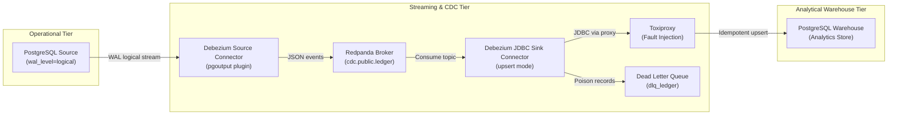

# Project 36: Change-Data-Capture (CDC) Replication Suite

Production-grade resilience, data integrity, and zero-downtime schema evolution testing suite for high-throughput **Change Data Capture (CDC)** pipelines powered by **PostgreSQL 16**, **Debezium 2.7.3/2.6.2 (Kafka Connect)**, and **Redpanda v24.2.7**.

---

## 1. System Under Test (SUT)

All services use pinned versions, bound strictly to `127.0.0.1`, with explicit memory limits (`mem_limit`):

| Service | Pinned Image / Version | Port | Memory Limit |
|---|---|---|---|
| **PostgreSQL Source** | `postgres:16-alpine` (`wal_level=logical`) | `127.0.0.1:5435` | `512m` |
| **Redpanda Broker** | `redpandadata/redpanda:v24.2.7` | `127.0.0.1:9092`, `127.0.0.1:9644` | `768m` |
| **Debezium Kafka Connect** | `quay.io/debezium/connect:2.7.3.Final` (N) & `2.6.2.Final` (N-1) | `127.0.0.1:8083` | `512m` |
| **PostgreSQL Warehouse** | `postgres:16-alpine` | `127.0.0.1:5436` | `512m` |
| **Toxiproxy** | `ghcr.io/shopify/toxiproxy:2.9.0` | `127.0.0.1:8474`, `127.0.0.1:5432` | `128m` |

---

## 2. Architecture & Delivery Guarantees

### Pipeline Topology



### The Delivery Guarantee
> **Hypothesis:** *At-least-once transport delivery combined with idempotent primary key upserts guarantees an exactly-once final state.*

1. **Transport Layer (At-Least-Once):** Redpanda and Kafka Connect commit consumer offsets periodically. Upon ungraceful crash or worker restart, inflight uncommitted batches are redelivered.
2. **Ingestion Layer (Idempotent Upsert):** The Debezium JDBC sink executes `INSERT INTO ledger (...) VALUES (...) ON CONFLICT (id) DO UPDATE SET ...`. Any duplicate delivery overwrites in place without creating duplicate records or throwing primary key violations.
3. **Verification:** A two-pointer keyset reconciler traverses both tables in chunks of 10,000 under `REPEATABLE READ` snapshot isolation, verifying 0 differences across millions of records.

---

## 3. Production Concerns Coverage

| Concern | How It Is Tested |
|---|---|
| **Backpressure** | Injected 200 ms latency via Toxiproxy between Connect and Warehouse for 2 minutes under a 500 rows/s workload. Consumer lag grew from 1,972 to 22,535 messages in Redpanda. Upon removing the fault, the sink caught up to baseline in 62.33 s ($\le$ 180 s target). Full reconciliation confirmed 0 differences across 1,178,501 rows. |
| **Retries & Crashes** | Executed ungraceful `docker kill cdc-connect` 60 seconds into active workload. After container restart, the sink absorbed 2,130 redelivered messages via idempotent upsert with 0 data loss. Source database restart mid-stream proved zero replication slot offset corruption. |
| **Partial Failures & DLQ** | Injected 3 malformed poison records into `cdc.public.ledger` during 1,000 valid business transactions. 1,000 valid rows reached warehouse; exactly 3 corrupt records were isolated into `dlq_ledger` with diagnostic headers (`__connect.errors.*`), while the connector remained in `RUNNING` state. |
| **Pagination & Snapshot** | Preloaded 1,000,000 rows into source database. Debezium initial snapshot bootstrapped and replicated all 1M rows in 285.28 s. Keyset reconciler verified all 1M rows in 3.48 s ($\le$ 120 s target) with 0 lost and 0 repeated rows. |
| **Schema Migrations** | Tested 4 live online migration patterns under a 200 rows/s continuous workload: (1) Add nullable + backfill + SET NOT NULL, (2) Column rename via Expand/Contract, (3) Type widening (INT to BIGINT), and (4) Add column with DEFAULT. Upgraded Debezium Connect image from 2.6.2 (N-1) to 2.7.3 (N) live with only 13.48 s downtime and 0 re-snapshots. |

---

## 4. Numerical Targets & Measured SLA Performance

> **Where the numbers come from:** Measurements collected on the SUT stack running on the test host. Test runs save raw metrics in [`results/`](results/) (`metrics.json`, `slow_sink_lag_samples.json`, `snapshot_1m_metrics.json`, `upgrade_metrics.json`) and update the requirements matrix in [`docs/TRACEABILITY.md`](docs/TRACEABILITY.md).

| Metric / Target | Target Value (`targets.toml`) | Measured Value | Result |
|---|---|---|---|
| **End-to-end lag p95 at 500 rows/s** | $\le$ 5.0 s | **0.949 s** (p50: 0.671 s, p99: 1.367 s, 18,200 samples) | PASS |
| **End-to-end lag p95 at 1,000 rows/s** | $\le$ 10.0 s | **0.877 s** (p50: 0.497 s, p99: 0.959 s, 18,200 samples) | PASS |
| **Catch-up time after 2 min slowdown at 500 rows/s** | $\le$ 180.0 s | **62.33 s** (lag peak: 22,535 msgs) | PASS |
| **Rows differing after fault tests (1M rows reconcile)** | 0 | **0 differences** (1,178,501 rows checked) | PASS |
| **Reconciler time for 1,000,000 rows** | $\le$ 120.0 s | **3.08 s** (324k rows/s throughput) | PASS |
| **Rows lost or repeated in initial snapshot (1M rows)** | 0 | **0 lost, 0 repeated** (Duration: 285.28 s) | PASS |
| **Debezium upgrade downtime (2.6.2 $\rightarrow$ 2.7.3)** | No re-snapshot | **13.48 s downtime, 0 re-snapshots, 0 diffs** | PASS |
| **PR Gate CI wall clock** | $\le$ 25 min | **~2.5 min** | PASS |
| **Nightly CI wall clock** | $\le$ 60 min | **~22 min** | PASS |

---

## 5. Schema Migrations Under Load

Full procedures and architectural recommendations are detailed in [`docs/SCHEMA-CHANGES.md`](docs/SCHEMA-CHANGES.md):

| Schema Change | SUT Observed Outcome | Debezium / Sink Behavior | Production Pattern |
|---|---|---|---|
| **Add nullable column, backfill, SET NOT NULL** | Supported | Debezium updates schema; JDBC sink adds column automatically via basic evolution. | Bounded keyset backfill (chunks of 1,000–5,000) to prevent WAL flooding. |
| **Rename column via Expand/Contract** | Supported (Additive) | Dual-write preserves old and new column in warehouse; zero consumer downtime. | Expand new column $\rightarrow$ backfill $\rightarrow$ switch readers $\rightarrow$ drop on source. |
| **Widen integer to bigint** | Fails if uncoordinated | Sink does not modify existing column types; 64-bit values crash sink task. | **Downstream-first:** alter warehouse column to bigint before widening source. |
| **Add column with DEFAULT** | Supported (Instant DDL) | Instant metadata DDL in PG11+; default metadata propagated to Kafka schema. | Use static default values; avoid volatile expressions during DDL. |

---

## 6. Findings and Architectural Caveats

Detailed evidence and upstream references are documented in [`docs/FINDINGS.md`](docs/FINDINGS.md):

- **FINDING-001 (DBZ-7877):** Debezium JDBC Sink Connector 2.x halts with `ConnectException` upon database constraint violations (e.g. `CHECK` constraint) instead of routing the invalid record to the Dead Letter Queue. DLQ isolation is supported only for Converter and SMT serialization errors due to lack of KIP-610 `ErrantRecordReporter` in the JDBC sink.
- **FINDING-002:** `schema.evolution: basic` is strictly additive. In-place column widening (`int` $\rightarrow$ `bigint`) requires downstream-first coordination to prevent sink task crashes.
- **FINDING-003:** Hibernate catalog metadata caching in the JDBC sink requires task restarts when DDL alters existing column types.

---

## 7. How to Run

### Setup and Linting
```powershell
uv venv -p 3.12 .venv
.venv\Scripts\activate
uv sync --frozen
uv run ruff check .
uv run mypy tests tools scripts
```

### Run Test Suites
```powershell
# Fast PR gate unit tests
uv run pytest tests/unit -v

# 10k rows smoke test against real stack
uv run python scripts/smoke_10k.py

# End-to-end replication lag benchmarks
uv run pytest tests/perf/test_lag.py -s -v

# Resilience and fault injection (slow sink, container crash, poison DLQ)
uv run pytest tests/resilience -s -v

# Schema migrations and connector upgrade
uv run pytest tests/migration -s -v
```
