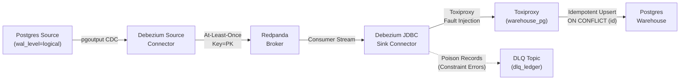

# Test Strategy — CDC Data Replication Pipeline

## 1. Core Delivery Guarantee Under Test

The central architectural hypothesis of this test suite is:

> **At-least-once delivery combined with idempotent upserts on the primary key guarantees an exactly-once final state.**

In distributed stream processing, network failures, container crashes, and slow sinks inevitably trigger message re-deliveries. Rather than attempting brittle two-phase commits across heterogeneous storage engines:
1. **Source Guarantee:** PostgreSQL logical decoding and Debezium produce events with **at-least-once semantics**, partitioned deterministically by the row's primary key (`id`).
2. **Sink Guarantee:** The Debezium JDBC Sink Connector writes events into the warehouse PostgreSQL database using **idempotent SQL `UPSERT` operations** (`INSERT ... ON CONFLICT (id) DO UPDATE SET ...`).
3. **Outcome:** Duplicate deliveries update the existing row in place with identical data, ensuring that once replication lag settles, the warehouse dataset matches the source database with **zero differences**.

---

## 2. Testing The 5 Production Concerns

| Concern | Failure Scenario Injected | Verification Method | Pass Criteria |
|---|---|---|---|
| **Backpressure** | Inject 200 ms downstream latency into warehouse via Toxiproxy for 2 min under 500 rows/s load. | Monitor consumer group lag via `rpk`, remove toxic, measure recovery time to baseline. | Catch-up time $\le$ 180 s; reconciliation finds 0 differences. |
| **Retries / Crash** | `docker kill` Connect worker container mid-stream; restart source Postgres mid-stream. | Restart containers, wait for RUNNING state, count absorbed redeliveries. | Connector recovers automatically; final state reconciles to 0 differences. |
| **Partial Failures** | Inject poison records violating warehouse `CHECK` or `VARCHAR` constraints. | Poll warehouse and DLQ topic using `confluent-kafka`. | Healthy rows (997/1000) ingested; exactly 3 land in DLQ with `__connect.errors.*` headers. Connector stays RUNNING. |
| **Pagination** | 1,000,000 row initial snapshot and continuous keyset reconciliation during concurrent writes. | Keyset pagination in chunks of 10k under `REPEATABLE READ` snapshot isolation. | Snapshot imports 100% rows with 0 lost/repeated; reconciler finishes in $\le$ 120 s with 0 false differences. |
| **Schema Migrations** | 4 DDL mutations applied under live 200 rows/s load (nullable column, rename, widen int to bigint, column with default). | Execute live DDL; assert automated evolution or explicit DLQ routing. | Documented in `docs/SCHEMA-CHANGES.md`; 0 data corruption. |

---

## 3. Test Suites and Execution Pyramid

1. **Unit & Reconciler Suite (`tests/unit/`):**
   - Validates the reconciler engine against deliberate tamper mutations (5 missing, 5 extra, 5 changed).
   - Validates snapshot isolation against concurrent live writes.
2. **Performance Suite (`tests/perf/`):**
   - Measures end-to-end replication lag at 100, 500, and 1,000 rows/s for sustained intervals.
   - Computes $p50$, $p95$, and $p99$ latencies using `qa_common.metrics.MetricsRecorder` and validates against `targets.toml`.
3. **Resilience & Fault Suite (`tests/resilience/`):**
   - Simulates sink degradation (Toxiproxy latency injection).
   - Simulates process crashes (`docker kill`, container restarts).
   - Validates poison pill isolation via Dead Letter Queue (DLQ).
4. **Migration & Snapshot Suite (`tests/migration/`):**
   - Tests expand/contract DDL migrations under active traffic.
   - Verifies 1M-row initial snapshot bootstrap.
   - Verifies zero-downtime engine upgrade from Debezium N-1 (`2.6.2`) to N (`2.7.3`).

---

## 4. Verification and Measurement Rules

- **Zero Tolerance for Data Divergence:** Any difference reported by the reconciler constitutes a critical failure.
- **Repeatable Measurements:** Latency and catch-up figures are captured across multiple runs.
- **No Flaky Sleep Checks:** All tests poll conditions with descriptive timeouts and explicit state assertions.
- **Hardware-Aware Baselines:** Performance numbers are benchmarked against the 4 vCPU target specified in `targets.toml`.
