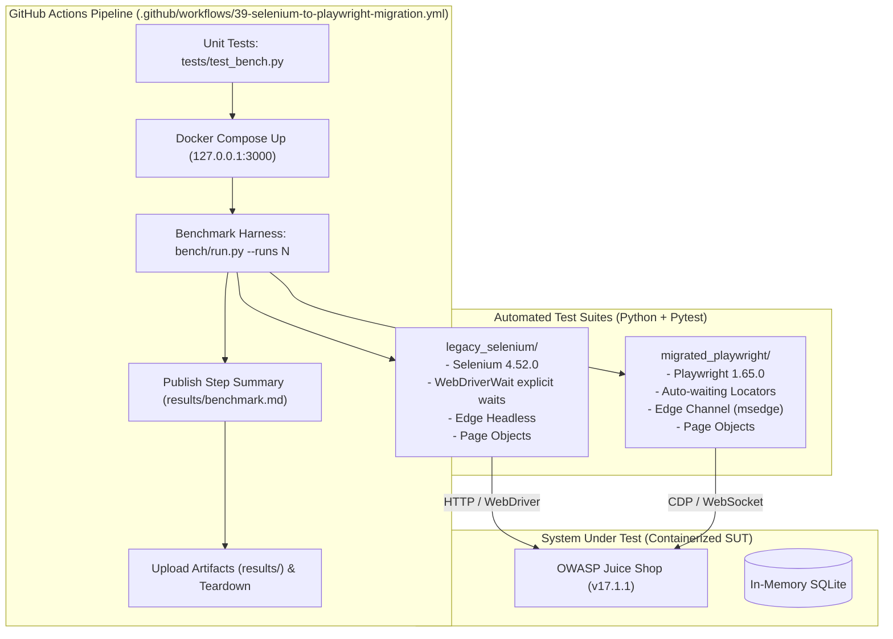

# 39 · Selenium 4 to Playwright Migration & Benchmark over OWASP Juice Shop

[](https://github.com/valarcon1226/qa-automation-portfolio/actions/workflows/39-selenium-to-playwright-migration.yml)
[](https://www.python.org/)
[](https://www.selenium.dev/)
[](https://playwright.dev/python/)
[](https://www.microsoft.com/edge)

An objective, measured migration case study: the **identical 8 end-to-end user journeys** implemented twice in Python—first using **Selenium 4** (with explicit `WebDriverWait` and Page Objects) and then using **Playwright** (with `pytest-playwright` and unified locators)—tested repeatedly against local containerized **OWASP Juice Shop** (`v17.1.1`) to measure execution velocity, intermittent failure rates, and code economy.

---

## 1. What Exists Today

- **System Under Test (SUT)**: Containerized OWASP Juice Shop (`v17.1.1`) running on `127.0.0.1:3000` with automated healthcheck validation.
- **Fair & Strict Comparison**:
  - Both suites exercise the exact same 8 test scenarios with identical test names.
  - Zero arbitrary sleeps (`time.sleep`) across both suites; Selenium uses explicit `WebDriverWait` and Playwright relies on built-in auto-waiting.
  - Microsoft Edge (`msedge` channel) headless in both frameworks.
  - Isolated test data factory via REST API (`POST /api/Users/`) ensuring zero inter-test dependency.
- **Automated Benchmark Harness (`bench/run.py`)**:
  - Built strictly with Python standard library modules (`argparse`, `subprocess`, `xml.etree.ElementTree`, `statistics`, `json`).
  - Executes each suite $N$ times with `pytest --junitxml`, parsing test durations and failures across runs.
  - Generates machine-readable `results/benchmark.json` and CI summary `results/benchmark.md`.
- **Migration Documentation**:
  - Code-level equivalence table and architectural differences detailed in [`docs/MIGRATION-GUIDE.md`](docs/MIGRATION-GUIDE.md).

---

## 2. Test Coverage & Scenario Mapping

All 8 scenarios are sourced from the verified user flows in `Portfolio-Automation/26-cypress-juice-shop/cypress/e2e`:

| Scenario ID | Test Function Name | Module | Description | Isolation Strategy |
| :---: | :--- | :--- | :--- | :--- |
| **01** | `test_login_valid` | Authentication | Authenticate valid user via UI form and verify session redirect | Disposable user created via API |
| **02** | `test_login_invalid` | Authentication | Reject invalid credentials and verify `.error` feedback message | Anonymous / Non-existent |
| **03** | `test_user_registration` | Authentication | Fill registration form, select security question, submit, verify redirect | Unique UUID timestamped email |
| **04** | `test_search_with_results` | Catalog | Search for `apple` and verify matching product cards rendered | Read-only search query |
| **05** | `test_search_without_results` | Catalog | Search for non-existent product and verify `emptyState` card | Read-only search query |
| **06** | `test_add_to_cart` | Basket | Add product to shopping basket and verify item presence | Dedicated authenticated session |
| **07** | `test_remove_from_cart` | Basket | Add product to basket, remove it, and verify basket is empty | Dedicated authenticated session |
| **08** | `test_language_change` | Localization | Open language menu, switch to German, verify `Konto` label in navbar | Dynamic UI language switch |

---

## 3. Architecture & Target Design



---

## 4. Getting Started & Local Execution

### Prerequisites

- Python `3.12+` and `uv` (or `py -m venv`)
- Docker & Docker Compose
- Microsoft Edge browser installed locally

### Installation

```bash
# Navigate to the project directory
cd Portfolio-Automation/39-selenium-to-playwright-migration

# Create virtual environment and install exact pinned dependencies
uv venv .venv
uv pip install -r requirements.txt
```

### Starting the SUT

```bash
# Start Juice Shop container and wait until healthy on port 3000
docker compose up -d --wait
```

### Running Test Suites Independently

```bash
# Run unit tests for benchmark harness
.venv\Scripts\python.exe -m pytest tests -q

# Run legacy Selenium 4 test suite
.venv\Scripts\python.exe -m pytest legacy_selenium -q

# Run migrated Playwright test suite
.venv\Scripts\python.exe -m pytest migrated_playwright -q
```

### Running the Comparative Benchmark

```bash
# Run 3 repeated iterations per suite (or --runs 10 for full sample)
.venv\Scripts\python.exe bench\run.py --runs 3

# View benchmark report
type results\benchmark.md
```

### Teardown

```bash
# Stop and remove container
docker compose down -v
```

---

## 5. Results

<!-- BENCH -->
numbers come from the CI run linked here.

---

## 6. Documentation Index

- [`docs/MIGRATION-GUIDE.md`](docs/MIGRATION-GUIDE.md): Code equivalence table (synchronization, locators, fixtures, session handling) and analysis of what did not improve.
- [GitHub Actions Workflow](file:///.github/workflows/39-selenium-to-playwright-migration.yml): Automated CI workflow executing repeated benchmark runs against live containerized SUT.
