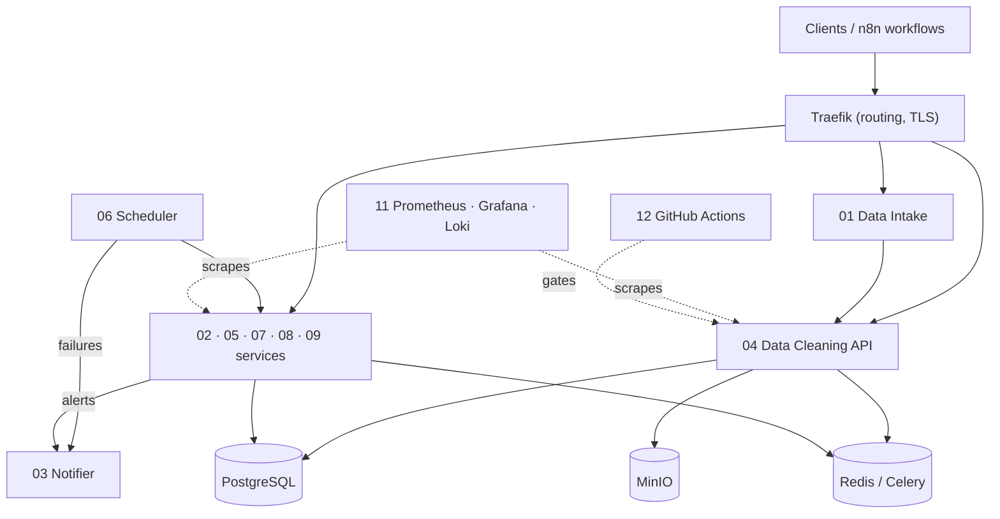

# Automation & Backend Engineering Portfolio

Twenty-six automation, backend, AI and QA projects: twelve core services (data intake, cleaning,
notifications, scheduling, OCR, scraping, observability, CI/CD) designed to run together as one
self-hosted stack, eleven client-facing builds for restaurants, e-commerce, AI agents and QA, and
three QA automation suites (24, 26, 27).

Every row below has code and tests. The *Evidence* column says where the tests ran: **CI** means
the GitHub Actions workflow runs them on every push to `main`; otherwise they were run locally
(or in Docker) during review. Each project README lists its limits.

## Current status (2026-10-16)

### Core services (01–12)

| #  | Project | What it does | Stack | Evidence |
| -- | ------- | ------------ | ----- | -------- |
| 01 | [Smart Data Intake](01-smart-data-intake/) | Ingests CSVs and sorts each row into clean, needs-review or error; a person reviews the doubtful ones in a panel | n8n, FastAPI, Pandas, Postgres, Redis, MinIO, Streamlit | 24 tests |
| 02 | [Business Registry Enricher](02-business-registry-enricher/) | Enriches company records from EU registries (VIES, Companies House, INSEE) with a 30-day cache and rate limits | n8n, FastAPI, Postgres, `aiolimiter`, `tenacity`, `zeep` | 72 tests |
| 03 | [Multi-Channel Notifier](03-multi-channel-notifier/) | One API for email, Slack, Telegram and Discord with templates, a queue, retries and a delivery log | FastAPI, Celery, Redis, Postgres, Jinja2 | 86 tests |
| 04 | [Data Cleaning API](04-data-cleaning-api/) | Cleans, validates and transforms CSV/Excel/JSON data for no-code workflows | FastAPI, Pandas, Pandera, Celery, Postgres, MinIO | 53 tests + 3 integration · 84% cov · CI · [risks](04-data-cleaning-api/docs/RISK-ANALYSIS.md) |
| 05 | [Invoice Processor](05-invoice-processor/) | OCR for PDF and image invoices; extracts tax fields and checks totals and the Colombian NIT check digit. One page answers at once; longer invoices go to a Celery queue | FastAPI, Tesseract, Celery, Postgres, MinIO | 24 tests · CI; 4 integration tests with real OCR in Docker |
| 06 | [Scheduler Engine](06-scheduler-engine/) | Visual cron replacement: schedules HTTP calls, commands and Python scripts with retries and alerts, behind a Bearer-token API | FastAPI, Celery Beat, Postgres, Redis, Streamlit | 27 tests + 2 integration |
| 07 | [Price Monitor](07-price-monitor/) | Tracks prices by polite scraping and the MercadoLibre API (with an SSRF guard), keeps history and alerts by webhook | FastAPI, Playwright, Celery, Postgres, Streamlit, Plotly | 38 tests + 2 integration |
| 08 | [Lead Generator](08-lead-generator/) | Finds businesses in directories and websites, removes duplicates, validates emails, scores leads and exports Excel | FastAPI, Playwright, Postgres, `rapidfuzz`, `openpyxl` | 70 tests |
| 09 | [News Aggregator](09-news-aggregator/) | Collects RSS and web news (http/https only, SSRF guard), removes duplicates by hash and pgvector, summarises with an LLM and emails an HTML digest | FastAPI, feedparser, trafilatura, Postgres + pgvector, Ollama | 27 tests + 1 integration |
| 10 | [Docker Compose Lab](10-docker-compose-lab/) | Shared production topology for all services | Docker Compose, Traefik, Postgres, Redis, MinIO, n8n, Prometheus, Grafana | Backend: 5 tests, 61% cov · CI; full stack run locally (10 services, 9 with healthchecks; TLS on a real domain not tested) |
| 11 | [Monitoring Dashboard](11-monitoring-dashboard/) | Prometheus scrapes every 5 s, Loki + Promtail collect logs, Alertmanager sends 5 alert rules, Grafana shows dashboards | Prometheus, Grafana, Loki, Alertmanager, Node Exporter, FastAPI | 13 tests + 6 integration |
| 12 | [CI/CD Pipeline](12-ci-cd-pipeline/) | Lint, type-check, SAST, tests, non-root image build, Trivy scan and manual rollback | GitHub Actions, Ruff, Mypy, Bandit, Testcontainers, Trivy, GHCR | 14 tests + 1 integration · 96% cov · [own CI](../.github/workflows/12-ci-cd.yml) |

### Client-facing builds (13–23)

| #  | Project | What it does | Stack | Evidence |
| -- | ------- | ------------ | ----- | -------- |
| 13 | [WhatsApp Restaurant Assistant](13-whatsapp-restaurant-assistant/) | Answers a restaurant's WhatsApp: orders, bookings, event requests and hand-off to staff | FastAPI, Postgres, WhatsApp Cloud API, LLM tools, BM25 | 147 tests |
| 14 | [n8n Automation Pack](14-n8n-automation-pack/) | Four flows: web form to CRM, invoice PDF to data with AI, daily AI sales report, payment to order | n8n, Postgres, Mailpit, LLM | 22 tests against a real n8n |
| 15 | [QA Showcase (Python)](15-qa-showcase/) | UI tests (Playwright on Edge) and API tests (httpx) on SauceDemo and Restful Booker, with 5 real bugs documented | Playwright, pytest, httpx, Postman | 13 passing + 5 tests that expose the documented bugs |
| 16 | [Restaurant Website](16-restaurant-website/) | WordPress site built from scratch by script, with booking and event forms and structured data | WordPress, WP-CLI, Docker, Playwright | 10 tests on Edge · Lighthouse 81 / 95 / 100 / 92 |
| 17 | [Multi-Agent Crews](17-multi-agent-crews/) | The same four-agent market-research team in CrewAI and AutoGen behind one API; tools record the sources | CrewAI, AutoGen, FastAPI, Ollama | 20 tests |
| 18 | [MCP Agent Evals](18-mcp-agent-evals/) | Restaurant tools over MCP plus 30 eval cases: right tool, no invented answers, prompt-injection resistance | MCP, SQLite, Ollama, pytest | 31 tests · 30/30 eval cases |
| 19 | [QA Java Suite](19-qa-java-suite/) | Selenium on Edge with JUnit 5 and Cucumber, REST Assured CRUD, Allure report | Java 21, Selenium, Cucumber, JUnit 5, REST Assured, Allure | 35 tests in Docker |
| 20 | [E-commerce Order Automation](20-ecommerce-order-automation/) | WooCommerce, Shopify and Stripe orders with verified signatures, no duplicates, customer email and a dashboard | FastAPI, MongoDB, Mailpit | 28 tests + end-to-end demo |
| 21 | [SEO & AEO Audit](21-seo-aeo-audit/) | Technical SEO, headings, schema, broken links, Lighthouse and answer-engine readiness, as an HTML or PDF report | FastAPI, BeautifulSoup, Lighthouse | 28 tests |
| 22 | [Web Chat Widget](22-web-chat-widget/) | One-line embeddable chat that talks to the project 13 assistant | JavaScript, FastAPI, Playwright | 4 tests |
| 23 | [Video Repurposing Kit](23-video-repurposing-kit/) | Transcribes a long video locally, picks the best moments and renders 9:16 clips with captions plus a YouTube pack | faster-whisper, FFmpeg, Ollama, FastAPI | 24 tests + a real 1080×1920 clip |

### QA automation suites (24–27)

| #  | Project | What it does | Stack | Evidence |
| -- | ------- | ------------ | ----- | -------- |
| 24 | [Playwright + TypeScript on ParaBank](24-playwright-ts-parabank/) | Banking UI tests checked against the REST API (transfers verified by balance), page objects as fixtures, one visual test | Playwright, TypeScript, Docker | 25 tests (10 API + 15 Edge) · CI ([workflow](../.github/workflows/24-playwright-ts-parabank.yml)); Firefox and WebKit on manual runs · 3 bugs |
| 26 | [Cypress + TypeScript on OWASP Juice Shop](26-cypress-juice-shop/) | Login, catalog, basket, checkout, API and network-failure tests, with security defects written up | Cypress, TypeScript, Docker | 23 tests on Edge · CI ([workflow](../.github/workflows/26-cypress-juice-shop.yml)) · 4 bugs |
| 27 | [API Contract Quality](27-api-contract-quality/) | Pact consumer contracts for the project 22 → 13 chat API, Schemathesis fuzzing of project 20's OpenAPI, Newman regression on Petstore | Pact, Pact Broker, Schemathesis, Newman | 3 contract tests + 17 Newman requests (49 assertions) · CI ([workflow](../.github/workflows/27-api-contract-quality.yml)); provider verification and fuzzing on manual runs · 3 bugs found in projects 13 and 20 |

## Target architecture

This diagram is the **target** wiring between the core services; project 10 runs the shared
topology, but the services are not yet deployed together.



## Quality approach

Borrowed from risk-based quality engineering practice; applied to 04, 10, 24, 26 and 27 so far:

1. **Risk analysis first.** A `docs/RISK-ANALYSIS.md` (04, 10, 24, 26, 27) rates what
   could hurt a user (probability × impact), including defects found in its own code.
2. **Traceability.** `docs/TRACEABILITY-MATRIX.md` (04, 24, 26, 27) maps every risk → scenario → test file.
   Scenarios without a test stay listed as `Not Implemented` rather than disappearing.
3. **Test the real artifact.** API tests import the production app object, so a route missing
   from the deployed service fails CI (this caught a real defect in project 04).
4. **One CI gate per service.** Lint → format → type-check → tests with coverage, with results
   uploaded as artifacts even when a step fails.
5. **Honest claims.** Coverage percentages are reported but not treated as proof of behaviour.

## Roadmap

| Phase | Scope                                                                    | Status      |
| ----- | ------------------------------------------------------------------------ | ----------- |
| 1     | Architecture, API contracts and build plans for the 12 core services     | Done        |
| 2     | Project 04 working and gated in CI; risk + traceability model            | Done        |
| 3a    | Project 04: API-key auth, safe errors, config and README contract fixes  | Done        |
| 3b    | Project 04: persisted job state, persisted schemas, Excel/JSON input     | Done        |
| 4     | Build 01 → 03 → 06 → 05 → 02 → 08 → 07 → 09 (order in [`docs/BUILD-PLAN.md`](docs/BUILD-PLAN.md)) | Done |
| 5     | Monitoring (11), full CI/CD with security scans (12), shared stack (10)  | Done        |
| 6     | Client-facing builds 13–23 (restaurant, e-commerce, AI agents, QA)       | Done        |
| 7     | QA automation suites 24, 26, 27 (Playwright, Cypress, contracts)         | Done        |
| 8     | QA projects on production open-source systems (Saleor, Paperless-ngx, Debezium, Keycloak, LiteLLM) | Planned     |
| 9     | Add the remaining Python services to the shared CI workflow              | Next        |

## Repository layout

```text
NN-project-name/
  README.md           Design: problem, architecture, schema, API, services
  EXECUTION_PLAN.md   Atomic checklist used to build it
  docs/               Risk analysis and traceability (implemented projects)
  app/ tests/         Code and tests (implemented projects)
docs/
  BUILD-PLAN.md       Build order and cross-project decisions
```

## Running a service

```bash
cd 04-data-cleaning-api
cp .env.example .env            # PowerShell: Copy-Item .env.example .env
pip install -r requirements-dev.txt
pytest --cov                    # unit + API tests, no external services needed
docker compose up -d            # api, worker, db, redis, minio
```
